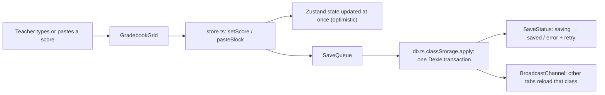
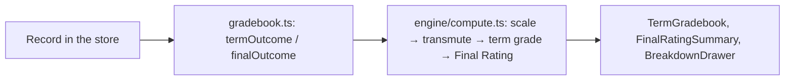
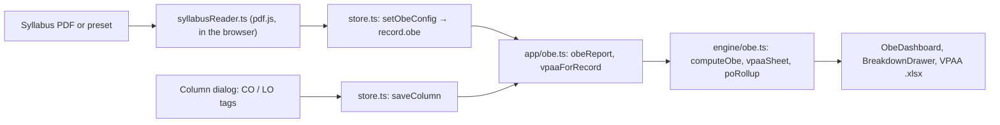

# Architecture

How data moves through the Mastersoft Grade Encoding Assistant. Update this file whenever a data flow is added or changed: give each flow a Mermaid diagram and four bullets (User Action → Component → Service → State Update).

## Overview

A static, client-side React app. There is **no server and no login**: student names, IDs and scores are processed and saved only in the teacher's browser (decisions D9 and D16 in `docs/02_project_blueprint.md`; RA 10173, Data Privacy Act of 2012). Firebase is used only for **Hosting** of the built files. After the first visit a service worker (`src/sw.js`) lets the app open without internet.

## Layers

| Layer | Files | Role |
|---|---|---|
| UI | `src/components/` | Gradebook grid, dialogs, summaries, OBE dashboard. Reads state, calls store actions. |
| State | `src/app/store.ts` | Zustand store: the loaded class records, the active view, save status. Every edit is a store action. |
| Persistence | `src/app/saveQueue.ts`, `src/app/db.ts` | Queues each edit as a *change* and applies it to the latest saved record in one IndexedDB transaction. |
| Engine (pure) | `src/engine/` | Mastersoft grade computation (`compute.ts`, `rounding.ts`, `rules.ts` + `rules/rules.v1.json`, `reverse.ts`, `status.ts`, `weightedCategories.ts`) and OBE attainment (`obe.ts`). No I/O, no React. |
| App logic | `src/app/gradebook.ts`, `src/app/obe.ts`, `src/app/progress.ts` | Turns a `ClassRecord` into engine inputs and results for the UI. |
| File I/O | `src/app/mastersoftFile.ts`, `src/app/excelImport.ts`, `src/app/encodingGuide.ts`, `src/app/syllabusReader.ts`, `src/app/backup.ts` | Mastersoft upload files, Excel import, printable guide, syllabus PDF reading, backup files. All local. |

## Storage schema

Dexie database `mastersoft-grade-encoding` (`src/app/db.ts`), **version 1**:

| Table | Key / indexes | Contents |
|---|---|---|
| `classes` | `id`, `updatedAt` | One `ClassRecord` per class and section |
| `meta` | `key` | App settings: `noticeSeen`, `activeClassId`, `backedUp` (backup fingerprints) |

`ClassRecord` (`src/app/types.ts`): `id`, subject code/name, section, `subjectType`, `terms` (`PRELIM`/`MIDTERM`/`FINAL` → `csMode`, `categories`, `columns` with `maxScore`, `component` CS/WE and optional OBE tags `coIds`/`loIds`, and `coWeights` — custom CO splits, which no screen edits yet: the column dialog keeps them when they come from a restored backup), `students` (scores stored **as typed text** by column id, statuses per term, optional reverse-mode target and Mastersoft row), optional `obe` config (POs, COs, LOs), `updatedAt`.

**Computed grades are never stored.** Every grade and OBE figure is recomputed from the record when shown, so a rules change or a fix can never leave stale results behind.

## Data flows

### Flow 1: Editing a score

- **User action:** the teacher types a score, pastes a block from Excel, or imports a file.
- **Component:** `GradebookGrid` / `TermGradebook` calls a store action (`setScore`, `pasteBlock`, `importScores`, …).
- **Service:** the action applies the edit to the in-memory record and queues it in `SaveQueue`; `classStorage.apply` re-applies the change to the **latest saved** record inside one IndexedDB transaction, so two open tabs never overwrite each other. Failed saves stay queued for **Retry**.
- **State update:** the store already shows the new value; `saveStatus` drives `SaveStatus.tsx`, and `announceChanges` tells other tabs, which reload the class from IndexedDB.

### Flow 2: Computing grades

- **User action:** any render of a gradebook, summary or breakdown (after an edit, a view change or a load).
- **Component:** `TermGradebook`, `FinalRatingSummary` and `BreakdownDrawer` ask `src/app/gradebook.ts` for each student's outcome.
- **Service:** `gradebook.ts` parses the score text and calls the pure engine (`scale`, `transmute`, `termGrade`, statuses, weighted categories) with the rules in `rules.v1.json`.
- **State update:** nothing is written; the results are rendered and discarded, and the next render recomputes them.

### Flow 3: OBE attainment

- **User action:** the teacher uploads the course syllabus (or picks a preset), checks the POs/COs/LOs, and tags gradebook columns with the COs and LOs they assess.
- **Component:** `ObeDashboard` (setup tab) and `ColumnDialogs` call `setObeConfig` and `saveColumn`; both are saved through Flow 1.
- **Service:** `src/app/obe.ts` hands the record to `src/engine/obe.ts`: `computeObe` (direct CO/LO attainment per student, per term and overall), `vpaaSheet` (VPAA CO Attainment: LO-count weight × Final Rating) and `poRollup` (class CO attainment rolled up to POs). The OBE engine only **reads** the gradebook; it never changes a grade.
- **State update:** results are computed on render (memoised in `ObeDashboard`) and can be exported as the VPAA workbook; nothing computed is stored.

## Precision rules

- **Grade engine:** every division and rounding step goes through `src/engine/rounding.ts`, which scales values to integers and rounds half-up exactly (decision D21), so an exact .5 is never stored as .4999… The golden tests in `tests/engine/fixtures.test.ts` compare results with real Mastersoft grade reports.
- **OBE engine:** all splitting, summing and dividing is exact (BigInt fractions, `src/engine/fraction.ts`). A column split 1/3 or 3/97 across COs never drifts, and a 40.625% is shown as 40.63%. Only the values shown are rounded, half-up to 2 decimals. For speed, each scope (term or overall) puts all its columns on one common whole-number scale once per class, so each student's totals are plain integer sums (about 50 ms for 50 students × 45 columns, even with different CO weights in every column).
  - A student attains an outcome when the **shown** 2-decimal raw % is at or above the pass mark: a 64.15% pass mark scored exactly is attained; against a 64.154% pass mark, 64.15% is not.
  - CO weights that are missing, negative or not a number count as 0; if all of a column's weights are 0, its points are split equally.
  - Scores, maximum scores and pass marks that are not plain decimals (e.g. `1e-7`) are skipped, or fall back to the default 60% pass mark, instead of breaking the dashboard.
  - Class means and the VPAA / PO formulas use whole-number hundredths and `roundHalfUpDiv`.

## Tooling

| Command | What it does |
|---|---|
| `npm run dev` | Vite dev server (no service worker) |
| `npm test` | Vitest: engine, app logic and requirement test cases |
| `npm run lint` | ESLint with typescript-eslint (type-aware) and the React hook rules |
| `npm run typecheck` | `tsc --noEmit` |
| `npm run build` | Typecheck, then the production build in `dist/` (with `sw.js`) |
| `npm run preview` | Serves `dist/` with the same security headers as Firebase Hosting |
| `npm run deploy` | Test, lint, build, then deploy to Firebase Hosting |

In Windows PowerShell use `npm.cmd` / `npx.cmd`.

**TypeScript is pinned to 6.0.3.** typescript-eslint (8.72) needs TypeScript's JavaScript compiler API, which TypeScript 7 no longer ships. Move back to TypeScript 7 once typescript-eslint supports it.
