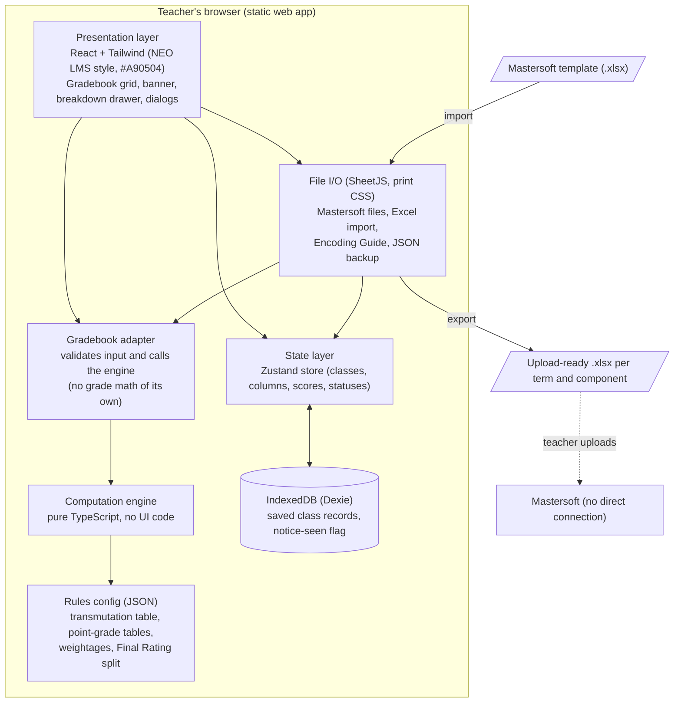
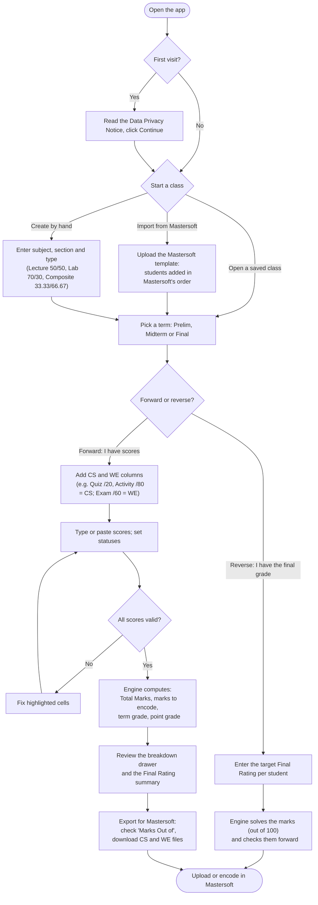
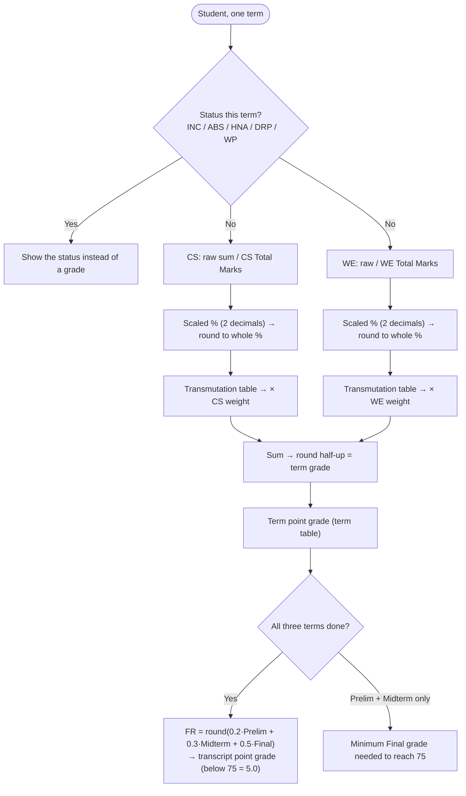

# Mastersoft Grade Encoding Assistant

A browser-based companion calculator for faculty of the University of San Agustin. It shows teachers **exactly what to enter in Mastersoft** and **exactly what grade Mastersoft will produce**, before they encode anything.

> [!NOTE]
> This is a personal project, **not an official system of the University of San Agustin**. It does not connect to Mastersoft. Everything runs in the teacher's browser, and student data never leaves the computer.

---

## Purpose

**The problem.** Teachers compute grades in Excel with their own formulas. Mastersoft computes grades differently:

- it rounds **twice** (the scaled % before transmuting, and the term grade after weighting);
- it uses a **step transmutation table**, not a linear formula;
- it treats Class Standing as **one combined raw total**.

So the grade students see in Mastersoft often doesn't match the teacher's own record, and teachers find out only after encoding.

**The goal.** Before encoding, the app shows:

1. the **Total Marks** to set on Mastersoft's Assessment Component screen (Class Standing and Written Exam, per term);
2. the **marks to encode** for each student;
3. the **predicted term grades, Final Rating and point grades**, with a step-by-step breakdown of how Mastersoft gets each one.

It also imports the student list from Mastersoft's upload template and exports **upload-ready Excel files**, so teachers don't have to re-type marks.

**Who it's for.** Faculty who encode grades every term, and the EdTech team who keep the grading rules (transmutation table, weightages) up to date.

---

## Features

| Area | What it does |
|---|---|
| **Step-by-step guide** | Each term shows four steps (add students, set up columns, enter scores, encode in Mastersoft), marks what is done, and offers the next action. A status bar counts graded, blank and invalid rows and jumps to the next blank or error. |
| **Gradebook** (NEO LMS style) | One record per class and section covering Prelim, Midterm and Final. Add Class Standing (CS) and Written Exam (WE) columns, then type or paste scores from Excel. |
| **Assessment Component banner** | The exact CS and WE Total Marks to set in Mastersoft, with copy buttons. |
| **Mastersoft output columns** | CS mark, WE mark, term grade and point grade for every student, computed by the engine. |
| **Breakdown drawer** | Each step, e.g. `113 / 130 → 86.92% → 87 → T 92 → × 0.50 = 46.00`. |
| **Class Standing modes** | *Raw sum* (Mastersoft default) or *Weighted categories* (e.g. Quiz 40% + Activity 60%), which converts to a mark out of 100. |
| **Statuses** | INC, ABS, HNA, DRP, WP per student per term. DRP and WP carry forward to later terms. |
| **Final Rating summary** | 20% Prelim + 30% Midterm + 50% Final, rounded half-up, plus the minimum Final grade needed to pass. |
| **Final Rating Only mode** | For classes where only the Final Rating is encoded (internship, thesis): enter each student's Final Rating and get the marks that make Mastersoft produce it. |
| **Excel import** | Import scores from your own class record: pick the sheet, the name/ID columns and the score columns (CS or WE, with max scores). Mappings can be saved as templates; blank and invalid cells are highlighted. |
| **Encoding Guide** | Per term: the Total Marks box and each student's marks and grades in Mastersoft's order. Print it, save it as PDF, or download it as `.xlsx`. |
| **Backup and restore** | Download a class as a JSON backup file and restore it on any computer. |
| **Mastersoft import / export** | Import the student list from Mastersoft's "Upload Grade Encoding" file, keeping its row order. Export Class Standing and Written Exam files in the same format, ready to upload. |
| **Warnings** | Amber "unverified" badges where a rule isn't yet confirmed against real Mastersoft data. Red highlights for invalid scores. |
| **Privacy** | Data Privacy Notice (RA 10173) on first launch. Records are saved only in this browser's IndexedDB. |

---

## System architecture

Everything is a static, client-side web app. There is no server and no login.



| Layer | Responsibility | Key rule |
|---|---|---|
| **Computation engine** (`src/engine`) | Scaling, rounding, transmutation, weighting, term grade, Final Rating, point grade, minimum Final needed, reverse solving | No UI dependencies; fully unit-tested |
| **Rules config** (`src/engine/rules/rules.v1.json`) | Transmutation table, point-grade tables, weightages, FR split | Data, not code. If Mastersoft changes a table, only this file changes |
| **Gradebook adapter** (`src/app/gradebook.ts`) | Turns a class record into engine inputs and returns the results | The UI never calculates grades itself |
| **State and storage** (`src/app/store.ts`, `db.ts`) | Current classes, columns, scores and statuses; auto-save | Data stays in the browser |
| **File I/O** (`src/app/mastersoftFile.ts`, `excelImport.ts`, `encodingGuide.ts`, `backup.ts`) | Mastersoft upload template, smart Excel import, Encoding Guide, backup/restore | Keeps Mastersoft's row order and text exactly; never computes grades itself |
| **Presentation** (`src/components`) | Gradebook, dialogs, drawer, summaries | Displays only what the engine returns |

---

## How a teacher uses it



---

## Computation pipeline (inside the engine)



All rounding is half-up on integer hundredths (`roundHalfUp`), never `Math.round` on a decimal, so an exact `.5` is never rounded down.

| Subject type | CS weight | WE weight |
|---|---|---|
| Lecture | 50% | 50% |
| Laboratory | 70% | 30% |
| Composite | 33.33% | 66.67% |

---

## Project structure

```text
.
├── docs/
│   ├── 01_mastersoft_computation_spec.md   # How Mastersoft computes grades (reverse-engineered)
│   ├── 02_project_blueprint.md             # Goals, architecture, phases, decision log (D1–D34)
│   ├── 03_architecture_and_flowcharts.md   # Detailed diagrams and screen layout
│   └── source/                             # Real spreadsheets and screenshots (git-ignored)
├── src/
│   ├── engine/                 # Pure TypeScript grade engine (no UI code)
│   │   ├── compute.ts          # scale, transmute, term grade, Final Rating, min Final needed
│   │   ├── reverse.ts          # Final Rating Only mode: target grade → marks
│   │   ├── status.ts           # INC/ABS/HNA/DRP/WP, carry-forward, FR status
│   │   ├── weightedCategories.ts
│   │   ├── rounding.ts         # roundHalfUp, sumMarks (exact decimal math)
│   │   ├── rules.ts
│   │   └── rules/rules.v1.json # Versioned rules data
│   ├── app/                    # State and adapters
│   │   ├── gradebook.ts        # Class record → engine → results
│   │   ├── mastersoftFile.ts   # Mastersoft upload template import/export
│   │   ├── excelImport.ts      # Smart import from teachers' own class records
│   │   ├── encodingGuide.ts    # Encoding Guide data and .xlsx export
│   │   ├── backup.ts           # JSON backup and restore
│   │   ├── store.ts            # Zustand store with auto-save
│   │   ├── db.ts               # IndexedDB (Dexie)
│   │   ├── types.ts            # Data model
│   │   └── labels.ts
│   ├── components/             # React UI (gradebook, dialogs, drawer, summaries)
│   │   └── ui/                 # shadcn-style primitives
│   ├── App.tsx
│   └── main.tsx
├── tests/
│   ├── engine/                 # Engine unit tests and real-data fixture tests
│   ├── app/                    # Adapter and Mastersoft file tests
│   └── fixtures/               # Anonymized test data (S01, S02, …)
├── index.html
├── package.json
└── vite.config.ts
```

---

## Tech stack

| Concern | Choice |
|---|---|
| Language | TypeScript |
| UI | React, Vite, Tailwind CSS, shadcn-style components (Radix UI) |
| State | Zustand |
| Local storage | IndexedDB via Dexie |
| Excel files | SheetJS (from cdn.sheetjs.com) |
| Tests | Vitest |

---

## Getting started

Requires [Node.js](https://nodejs.org/) 22 or later.

```bash
git clone https://github.com/mjbadorable/Mastersoft-Grade-Encoding-Assistant.git
cd Mastersoft-Grade-Encoding-Assistant
npm install
npm run dev
```

Then open the address Vite prints (usually http://localhost:5173).

| Command | What it does |
|---|---|
| `npm run dev` | Start the app locally |
| `npm test` | Run all tests |
| `npm run typecheck` | Check TypeScript types |
| `npm run build` | Build static files into `dist/` |
| `npm run preview` | Serve the built app locally with the same security headers as Firebase Hosting |
| `npm run deploy` | Run the tests, build, and publish to Firebase Hosting |

---

## Deploying (Firebase Hosting)

The app is a static site: Firebase only serves its files. Grades stay in each teacher's browser, and the security headers in [firebase.json](firebase.json) block the page from connecting to any other site.

One-time setup:

1. Create a Firebase project (free Spark plan, Google Analytics off) at [console.firebase.google.com](https://console.firebase.google.com).
2. Sign in from this folder: `npx firebase-tools@15 login`
3. Link the project: `npx firebase-tools@15 use --add` (choose the project, alias `default`). This writes `.firebaserc`.

Each release: `npm run deploy`. The app is then at `https://<project-id>.web.app`.

Saved classes belong to the address they were made on: classes made on `localhost` do not appear on the hosted site. Move them with **Backup** and **Restore**.

## Accuracy and testing

- The engine is tested against real Mastersoft results (GE 6, EE 231a, EE 231 grade reports) and the MLS Internship sheet, with student names replaced by IDs.
- The Mastersoft import/export is tested on an anonymized copy of a real upload template.
- Rules that aren't yet confirmed against a real Mastersoft example are marked **unverified** in the app (see decisions D20, D30–D32 in the blueprint).

## Data privacy

Student names, IDs and scores are processed and saved only in the teacher's browser (IndexedDB). The app has no server and no login, and it doesn't upload, collect or share any data. Student records are personal information under **Republic Act No. 10173 (Data Privacy Act of 2012)**; real class files are kept out of this repository.

## Roadmap

| Phase | Status |
|---|---|
| 1. Computation engine and tests | Done |
| 2. Gradebook UI, Final Rating Only mode, Mastersoft import/export | Done |
| 3. Import from teachers' own Excel class records, PDF/.xlsx Encoding Guide, backup/restore | Done |
| 4. Pilot with faculty; add a raw-mark test case from Mastersoft | Planned |
| 5. Optional accounts and admin backend | Optional |
