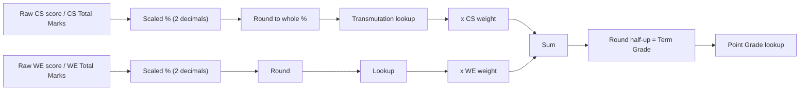

# Mastersoft Grade Computation: Reverse-Engineered Spec (Draft)

Sources: your sheet's tabs (`LAB`, `LEC`, `Short Version`, `Transmutation Table`) and your screenshots.

> [!NOTE]
> **Evidence status (D33):** the raw-mark steps (scaling and the transmutation lookup) were checked once against all **12 student rows** of the *Grade Submissions* screenshot (BSED SS 3-A) and the *Grade Encoding* screen, and all 12 matched. **Those screenshots are no longer available**, so that check can't be re-run and isn't part of the automated tests. The examples in the §1 table below come from them. Re-runnable evidence: `tests/fixtures/mastersoft-grade-reports.json` (GE 6, EE 231a, EE 231) and `tests/fixtures/mls-internship-sheet.json`.

## 1. Pipeline per term (Prelim / Midterm / Final)

| Step | Formula | Proof from screenshot (no longer available, see note above) |
|---|---|---|
| Scaled % | `raw / total × 100` | 49/50 → 98.00 (Grade Encoding screen) |
| Transmute | `T[ round(scaled) ]` | 92.78 → 93 → **96**; 90.56 → 91 → **94**; 86.67 → 87 → **92** |
| Weighted | `T_cs × w_cs`, `T_we × w_we` | 96 × 0.5 = 48.00; 91 × 0.5 = 45.50 |
| Term grade | `round_half_up(sum)` | 47 + 44.5 = 91.5 → **92** (1.7); 48 + 45.5 = 93.5 → **94** (1.5) |
| Point grade | `P[ term grade ]` | 94 → 1.5, 93 → 1.6, 91 → 1.7, 89 → 1.9 |

> [!NOTE]
> **Rounding rules for the engine (D20, D21):**
> - Mastersoft shows the scaled % with 2 decimals, so the engine rounds **twice**: first to 2 decimals, then to a whole %. This only differs from a single rounding when the raw % is between x.495 and x.499 (e.g. 89.496 → 89.50 → **90**, not 89). No verified example covers that range yet, so the app marks those cases with an amber **"unverified boundary"** badge until a real Mastersoft example confirms it.
> - All rounding is **half-up** (`.5` rounds up) and uses a dedicated `roundHalfUp` function on integer hundredths (`marks × 10000 ÷ total`), never `Math.round` on a decimal result, so an exact `.5` can't be stored as `.4999…` and rounded down.

> [!IMPORTANT]
> **Why Excel sheets don't match:** Mastersoft rounds in **two places** (scaled % before transmuting, and the term grade after weighting), and it uses a **step table** instead of a linear formula. It also treats Class Standing as **one combined raw total**. So if a teacher's Excel weights quizzes and activities separately *inside* Class Standing (e.g. Quiz 40% + Activity 60%), the result will differ from Mastersoft.

## 2. Transmutation table (% → Transmuted)

| % | T | % | T | % | T | % | T |
|---|---|---|---|---|---|---|---|
| 100 | 100 | 87 | 92 | 74 | 84 | 61 | 76 |
| 99 | 99 | 86 | 91 | 73 | 83 | 60 | 75 |
| 98 | 99 | 85 | 91 | 72 | 83 | 57–59 | 74 |
| 97 | 98 | 84 | 90 | 71 | 82 | 50–56 | 73 |
| 96 | 98 | 83 | 89 | 70 | 81 | 46–49 | 72 |
| 95 | 97 | 82 | 89 | 69 | 81 | 42–45 | 71 |
| 94 | 96 | 81 | 88 | 68 | 80 | 38–41 | 70 |
| 93 | 96 | 80 | 88 | 67 | 79 | 34–37 | 69 |
| 92 | 95 | 79 | 87 | 66 | 79 | 30–33 | 68 |
| 91 | 94 | 78 | 86 | 65 | 78 | 26–29 | 67 |
| 90 | 94 | 77 | 86 | 64 | 78 | 22–25 | 66 |
| 89 | 93 | 76 | 85 | 63 | 77 | 18–21 | 65 |
| 88 | 93 | 75 | 84 | 62 | 76 | 14–17 | 64 |
| | | | | | | 10–13 → 63, 6–9 → 62, 2–5 → 61, 0–1 → 60 | |

**Below 38% (D30):** the engine uses the **whole-number ranges** above, not the sheet's 0.25-step values (37% → 69.25, 36% → 69, 35% → 68.75 …). Evidence: the GE 6 / EE 231 / EE 231a screenshots contain four transmuted grades in this range (**62, 65, 67, 69**), all whole numbers. With 0.25 steps only 1 percentage in 4 gives a whole number, so four in a row would be unlikely (about 0.4%). This isn't proof, because the raw marks aren't visible, so any CS or WE score **below 38%** gets an amber **"unverified"** badge until a Mastersoft case with raw marks confirms it.

**Transmuted → Point grade:** 100=1.0, 99=1.1, 98=1.2, 97–96=1.3, 95=1.4, 94=1.5, 93=1.6, 92–91=1.7, 90=1.8, 89=1.9, 88=2.0, 87–86=2.1, 85=2.2, 84=2.3, 83=2.4, 82–81=2.5, 80=2.6, 79=2.7, 78=2.8, 77–76=2.9, 75=3.0.

**Below 75 there are two tables (D19):**

| Used for | Below 75 |
|---|---|
| **Term grades** (Prelim / Midterm / Final) | Internal scale **3.1–3.9** for 68–74; **5.0** for 60–67 (D36) |
| **Final Rating** (transcript) | Always **5.0** (sheet column "point grade (Transcript)") |

**Term point grades below 75 (D31, D32, D36).** Mastersoft gives **5.0** to any term grade whose point grade would be worse than 3.9 (term grades 60–67), confirmed by the user on 2026-10-18 (D36). For 68–74, source: the sheet's `Transmutation Table` tab (read 2026-10-18), which lists point grades per percentage; values are taken at the first matching row, as the sheet's own `VLOOKUP` does, and rounded to 1 decimal as Mastersoft displays them. The app shows an amber **"unverified"** badge next to every unverified value.

| Term grade | 74 | 73 | 72 | 71 | 70 | 69 | 68 | 67 | 66 | 65 | 64 | 63 | 62 | 61 | 60 |
|---|---|---|---|---|---|---|---|---|---|---|---|---|---|---|---|
| **Term point grade** | 3.1 | **3.2** | 3.4 | 3.6 | **3.7** | 3.8 | 3.9 | **5.0** | **5.0** | **5.0** | **5.0** | **5.0** | **5.0** | **5.0** | **5.0** |
| Status | unverified | ✓ verified (EE 231) | unverified | unverified | ✓ verified (EE 231) | unverified | unverified | ✓ (D36) | ✓ (D36) | ✓ (D36) | ✓ (D36) | ✓ (D36) | ✓ (D36) | ✓ (D36) | ✓ (D36) |

Notes:
- **73 always maps to 3.2.** The sheet also lists 3.3 for 73 (at 50–53%), but the EE 231 screenshot shows 3.2.
- No term grade maps to **3.5** in the sheet.
- For 68–69 the sheet's raw values are fractional (e.g. 3.933…); the table shows them rounded to 1 decimal. The sheet's 4.1–4.9 values for 60–67 are **not** used: Mastersoft shows 5.0 there (D36).
- **Low risk:** term point grades are display-only. The Final Rating is computed from the transmuted term grades, and a Final Rating below 75 is always 5.0, so an unverified value here can't change a final grade.

> [!NOTE]
> The per-item columns in the sheet (5, 10, … 200 items) are just pre-computed versions of `round(raw/total×100)`, so the app only needs the % table above. It can then support **any** Total Marks value, not only multiples of 5.

## 3. Weightages (CS / WE) & Final Rating

| Subject type | Class Standing | Written Exam |
|---|---|---|
| Lecture | 50% | 50% |
| Laboratory | 70% | 30% |
| Composite (Lec + Lab) | 33.33% | 66.67% |

### Final Rating (20% Prelim + 30% Midterm + 50% Final)
Verified against the **EE 231a (Lab)** and **EE 231 (Lec)** Mastersoft screenshots:
1. **Term Grades are rounded half-up (`.5` rounds up) before computing FR:**
   - EE 231a Prelim: `70.00 + 18.60 = 88.60` → **89.00** (1.9)
   - EE 231a Midterm: `70.00 + 20.70 = 90.70` → **91.00** (1.7)
   - EE 231a Final: `51.80 + 27.30 = 79.10` → **79.00** (2.7)
   - EE 231 Midterm: `40.00 + 32.50 = 72.50` → **73.00** (3.2)
   - EE 231 Final: `42.00 + 36.50 = 78.50` → **79.00** (2.7)
2. **Final Rating uses the rounded Term Grades and rounds half-up (`.5` rounds up) before looking up Point Grade** (transcript table, so below 75 = 5.0):
   - **EE 231 (Lec):** `0.2(70) + 0.3(73) + 0.5(79) = 14 + 21.9 + 39.5 = 75.4` → rounds to **75** → Point Grade **3.0** ✓ *(proves it does not average point grades: `0.2(3.7) + 0.3(3.2) + 0.5(2.7) = 3.05` would fail)*
   - **EE 231a (Lab):** `0.2(89) + 0.3(91) + 0.5(79) = 17.8 + 27.3 + 39.5 = 84.6` → rounds to **85** → Point Grade **2.2** ✓ *(proves `84.6` rounds up to `85` instead of truncating to `84`, which would be `2.3`)*

## 4. Proposed app modes

1. **Forward / "Preview before encoding" (main goal).** The teacher enters her existing class-record columns as they are (e.g. Quiz /50, Summative /40, Participation /30, Attendance /10) plus the term exam. The app then shows:
   - **What to type in Assessment Components:** CS Total = 130, WE Total = 60
   - **What to type in Grade Encoding per student:** CS mark (sum of raw scores), WE mark
   - **Mastersoft's exact result:** scaled %, transmuted grade, term grade, point grade, with the step-by-step breakdown
   - Optionally, a **"Your Excel says X, Mastersoft will say Y"** comparison column to flag mismatches before submission
2. **Reverse (your current sheet; internship/thesis).** Enter the Final Rating and the app outputs the marks to encode so Mastersoft reproduces that grade. The target can be a transmuted grade (60–100) or a point grade (1.0–3.0 or 5.0); a 5.0 target also needs an exact transmuted grade (60–74), because 5.0 alone doesn't identify one (D28).
3. **Export** a CSV matching Mastersoft's *Upload Grade Encoding* format, if that tab accepts uploads.
