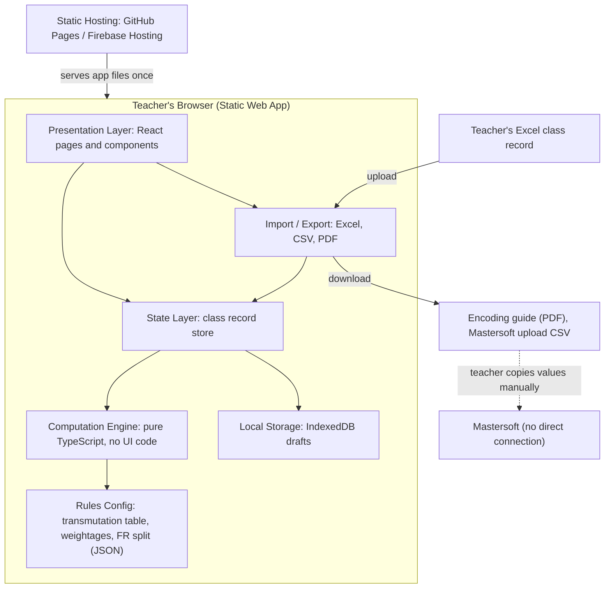
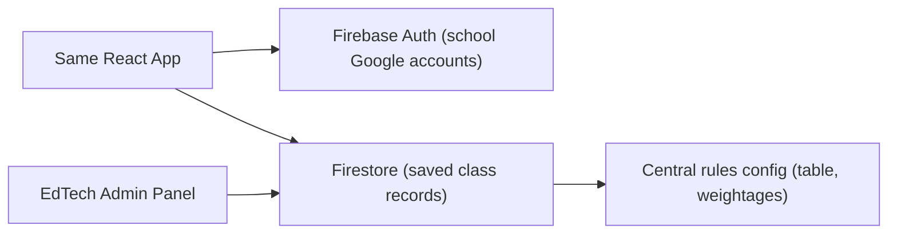
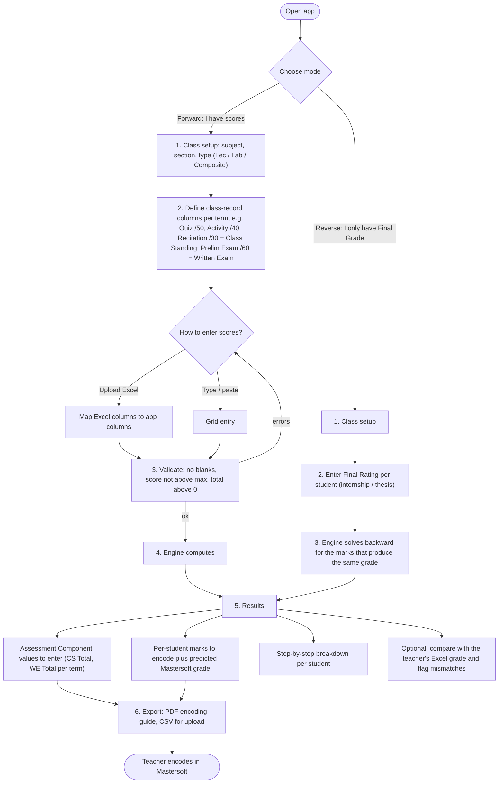
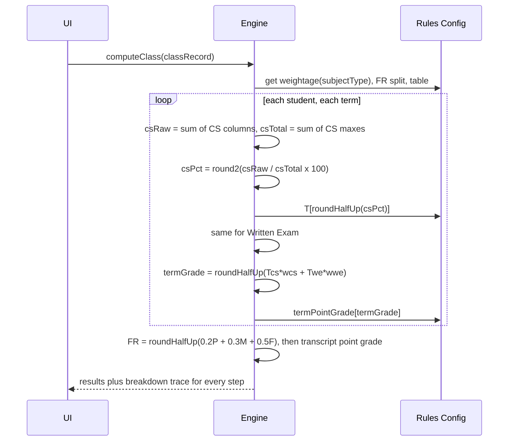
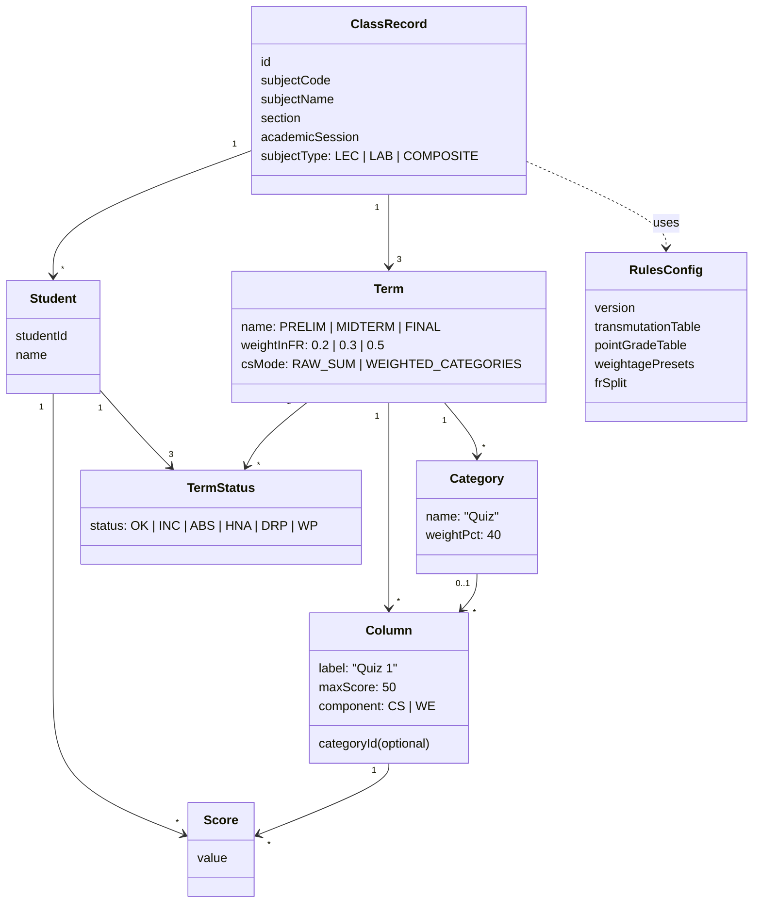
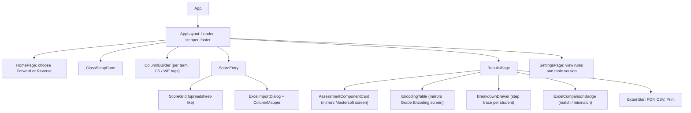
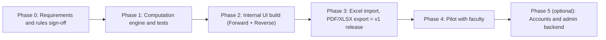

# Mastersoft Grade Encoding Assistant: Project Blueprint

> [!NOTE]
> This is the **planning document only**. It contains no code. The grade formulas come from [01_mastersoft_computation_spec.md](01_mastersoft_computation_spec.md).

---

## 1. Problem & Goal

| | |
|---|---|
| **Problem** | Teachers compute grades in Excel using their own formulas. Mastersoft uses a different method (rounding twice, a step transmutation table, and one combined Class Standing total), so the grades students see in Mastersoft don't match the teacher's record. |
| **Goal** | Before a teacher encodes anything, show her **exactly what to enter in Mastersoft** (Assessment Component totals and the marks for each student) and **exactly what grade Mastersoft will produce**, with a breakdown of each step. |
| **Non-goal** | Replacing Mastersoft or connecting to it directly. The app is a **companion calculator**: it doesn't log in to Mastersoft or pull data from it. |

### Target users
- **Faculty**: the main users. They encode grades every term.
- **EdTech team**: support staff. They keep the transmutation table and weightages up to date.

---

## 2. Confirmed Computation Rules

| Rule | Value |
|---|---|
| Lecture weightage (CS / WE) | 50 / 50 |
| Laboratory weightage (CS / WE) | 70 / 30 |
| Composite weightage (CS / WE) | 33.33 / 66.67 ✓ |
| Term grade | `round(T[round(CS%)]·w_cs + T[round(WE%)]·w_we)` |
| **Final Rating** | **20% Prelim + 30% Midterm + 50% Final** |
| Point grade | Looked up from the transmuted grade. Below 75: **term grades** use the internal 3.1–4.9 scale (table in spec §2; only 70 and 73 are verified, the rest carry an "unverified" badge); the **Final Rating** is 5.0 |
| Rounding | Half-up, done in integer hundredths by `roundHalfUp` (never `Math.round` on a decimal). Scaled % is rounded to 2 decimals, then to a whole % |
| Empty Total Marks | Not allowed. Mastersoft rejects it ("total marks value should be 100"), and the app will block it the same way. |

---

## 3. System Architecture

The recommended first version is a **client-side web app**: everything runs in the teacher's browser. There is no server, no login, and student data never leaves her computer, which keeps it compliant with the Data Privacy Act.

### Layer responsibilities

| Layer | Responsibility | Key rule |
|---|---|---|
| **Computation Engine** | Every formula: scaling, rounding, transmutation, weighting, term grade, FR, point grade, reverse solving | Has **no UI dependencies**, so it is 100% unit-testable and can be reused in a backend later |
| **Rules Config** | Transmutation table, weightage presets, FR split | Stored as **data, not code**. If Mastersoft changes the table, only the JSON is updated |
| **State Layer** | Holds the current class, students, columns and scores | Single source of truth |
| **Presentation** | Wizard screens, tables, breakdown panels | Never calculates anything itself; only displays what the engine returns |
| **Import / Export** | Parses Excel/CSV files and produces the PDF guide and upload CSV | The upload CSV format is pending the template |

### Future option (Phase 3): adding a backend
If the university later wants accounts, saved records or admin control:

Because the engine is already separate from the UI, this upgrade **doesn't require rewriting any formulas**.

---

## 4. User Flowchart

---

## 5. Computation Engine Flow

**Engine functions (planned API)**

| Function | Purpose |
|---|---|
| `scale(raw, total)` | Raw score → percentage with 2 decimals |
| `transmute(pct)` | Rounded % → transmuted grade |
| `termGrade(cs, we, weights)` | Weighted sum, rounded |
| `roundHalfUp(value)` | Half-up rounding on integer hundredths; every rounding step uses it |
| `pointGrade(grade, scale)` | Transmuted grade → point grade, using the `term` table (3.1–4.9 below 75) or the `transcript` table (5.0 below 75) |
| `finalRating(p, m, f)` | 20/30/50 split |
| `minFinalNeeded(p, m)` | Lowest Final term grade that still gives FR ≥ 75 (see D26 for the edge cases) |
| `solveReverse(targetFR, totals)` | Finds the marks to encode for a target Final Rating (reverse mode) |
| `explain(...)` | Returns a readable trace of each step for the breakdown panel |

---

## 6. Data Model

**Categories (D25):** each term has its own categories (e.g. Quiz 40%, Activity 60%), because teachers often change the mix between Prelim and Finals. The weights in a term must add up to 100%. They are only used when the term's `csMode` is `WEIGHTED_CATEGORIES`; in `RAW_SUM` mode they are ignored.

**Statuses (D23):** statuses (INC, ABS, HNA, DRP, WP) mirror the checkboxes on Mastersoft's Grade Encoding screen, which is per term, so they are stored **per student per term**. A student with a status in a term is skipped in that term's calculation and shown as a label instead of a grade. DRP and WP carry forward to the later terms automatically. A status in any term blocks the Final Rating, which shows the most serious status instead: **DRP > WP > INC > HNA > ABS**.

---

## 7. Component Breakdown (UI)

> [!TIP]
> **Key UX idea:** the result cards **look like Mastersoft's own screens** (the same labels: "Prelim – Class Standing", "Total Marks", "Marks / 60", "Scaled 100%"). Teachers can then copy values field by field without having to translate anything.

---

## 8. Recommended Tech Stack

| Concern | Choice | Why |
|---|---|---|
| Language | **TypeScript** | Type safety matters for grade math; catches mistakes like typing `"50"` instead of `50` |
| UI framework | **React 18** | Largest ecosystem, easy to hire or hand off |
| Build tool | **Vite** | Fast, simple, produces static files |
| Styling | **Tailwind CSS + shadcn/ui** | Clean, accessible components; consistent design quickly |
| Data grid | **TanStack Table** (or AG Grid Community) | Spreadsheet-like score entry and paste-from-Excel |
| State | **Zustand** | Lightweight, simple to learn |
| Validation | **Zod** | Schema checks for imported data and inputs |
| Excel import/export | **SheetJS (xlsx)**, installed from cdn.sheetjs.com (the npm `xlsx` package is outdated) | Reads teachers' existing `.xlsx` class records; Mastersoft builds its upload files with SheetJS too (D34) |
| PDF export | **jsPDF + autoTable** (or browser print CSS) | Printable "encoding guide" |
| Local persistence | **IndexedDB (via Dexie)** | Drafts survive a page refresh; stays on the device |
| Testing | **Vitest** (engine) + **Playwright** (end-to-end) | Engine tests use the 12 verified real student rows as fixtures |
| Hosting | **GitHub Pages / Firebase Hosting** | Free, static, HTTPS |
| Future backend | Firebase Auth + Firestore | Only if accounts or saving are needed (Phase 3) |

**A simpler alternative**, if the team is not comfortable with React: plain HTML + vanilla JavaScript + Tailwind, with the engine as a single `engine.js` file. It's quicker to start, but harder to maintain once the app has many screens.

---

## 9. Design Direction (NEO LMS Gradebook Style)

| Aspect | Decision |
|---|---|
| **Visual Reference** | **NEO LMS Gradebook layout** (`usa.neolms.com`) — familiar to faculty: top crimson header bar, left collapsible class/term navigation sidebar, top action & filter toolbar, and a spreadsheet-like gradebook matrix |
| **Branding & Colors** | **No university logo** (personal project). Primary accent color: **`#A90504` (Crimson Red)**, paired with clean white/light-gray surfaces (`#F8FAFC`), slate borders, and semantic status badges (**green** = matches Mastersoft, **amber** = rounding boundary/warning, **red** = invalid or failing `5.0`) |
| **Typography** | `Poppins` / `Inter` (matching NEO LMS portal fonts) + tabular numerals (`font-variant-numeric: tabular-nums`) so all grade columns align vertically |
| **Main Layout** | **NEO LMS Gradebook Matrix** instead of a multi-page wizard:<ul><li>**Left Sidebar:** Class selector, Term tabs (Prelim / Midterm / Final / Final Rating Summary), Mode switcher (Forward / Reverse), Data Privacy Notice link</li><li>**Top Action Bar:** Subject type pill (`Lecture 50/50`, `Lab 70/30`, `Composite 33.33/66.67`), CS Weighting toggle (`Raw Sum` vs `Weighted Categories`), `+ Add Assignment Column`, `Import Excel`, `Export Guide (PDF / XLSX)`</li><li>**Pinned Top Summary Card:** Live **Mastersoft Assessment Component** box showing exact `Total Marks` to encode for CS and WE</li><li>**Main Spreadsheet Grid:** Pinned left columns (`#`, `Student ID`, `Student Name`, `Status`) + scrollable assessment columns (grouped under Class Standing and Written Exam headers) + pinned right **Mastersoft Output Columns** (`CS Marks to Encode`, `WE Marks to Encode`, `Term Grade`, `Point Grade`)</li></ul> |
| **Inline Editing & Breakdown** | Click any cell to type/paste scores directly (like NEO LMS). Click any student's output grade to open a **Step-by-Step Breakdown Drawer** (`48 / 50 → 96.00% → 96 → T 98 → ×0.5 = 49.00`) |
| **Data Privacy Notice** | Built-in **Data Privacy Notice** written for this app (D27), shown on first launch with a *"Continue"* button (no consent checkbox, since the app collects nothing) and available anytime from the sidebar/footer. It cites **Republic Act No. 10173 (Data Privacy Act of 2012)**, states that all grade computations and class records stay in the user's browser (`IndexedDB`), and states that the app is not an official University system |
| **Accessibility & Devices** | WCAG 2.1 AA contrast, full arrow-key/Enter/Tab spreadsheet navigation, desktop-first layout |

### Data Privacy Notice (Text for Modal & Footer, draft for review)

> **DATA PRIVACY NOTICE**
>
> This app helps you preview how Mastersoft will compute your students' grades. It is a personal project and **not an official system of the University of San Agustin**.
>
> **Your data stays on this computer.** Student names, IDs and scores are processed and saved only in this browser (IndexedDB). The app has no server and no login, and it does not upload, collect or share any data.
>
> **You remain responsible for the data you enter.** Student records are personal information under **Republic Act No. 10173 (Data Privacy Act of 2012)**. Please:
> - use the app only on a computer you trust;
> - store exported files (PDF, Excel, backup) securely and delete them when you no longer need them;
> - clear the app's saved data if you use a shared computer.
>
> **[ Continue ]**

---

## 10. Development Phases

**Status (2026-10-18):** Phase 1 engine built in `src/engine/` (rules in `src/engine/rules/rules.v1.json`), with 96 passing tests in `tests/engine/` (`npm test`). Not yet covered: a raw-mark case from Mastersoft (see D33).

**Status (2026-10-18, Phase 2):** gradebook UI built (`npm run dev`), plus the Mastersoft upload-file import and export (D34), brought forward from Phase 3. 119 tests pass. Phase 3 still has the general import from teachers' own Excel class records, the PDF Encoding Guide and backup/restore.

The phases are the **build order**. The **v1 release** (what teachers receive) is the result of **Phases 1–3** together (D22); nothing is released to teachers after Phase 2 alone, because the app isn't useful without import and the encoding guide.

| Phase | Deliverables | Exit criteria |
|---|---|---|
| **0. Sign-off** | This blueprint and the computation spec approved; composite orientation and FR rounding confirmed; term point-grade table (3.1–4.9) read from the sheet | Rules frozen as v1 |
| **1. Engine** | TypeScript engine, rules JSON, unit tests | Every case in `tests/fixtures/mastersoft-grade-reports.json` (GE 6, EE 231a, EE 231) and `tests/fixtures/mls-internship-sheet.json` reproduces **100% identically** |
| **2. Internal UI build** | NEO LMS-style gradebook grid, inline column builder, Mastersoft Assessment Component header, breakdown drawer, reverse mode, Data Privacy Notice | A teacher can enter/paste scores and immediately see exact Mastersoft encoding values |
| **3. I/O (v1 release)** | Smart Excel import with column mapper; printable PDF Encoding Guide; `.xlsx` export | Real class records import cleanly; v1 released to pilot faculty |
| **4. Pilot** | 3–5 faculty use it for one term; **capture at least one Grade Encoding screen with raw marks** (any class, can be done earlier) and add it as a test case (D33) | Zero mismatches between the app's prediction and the grade Mastersoft actually produces; the raw-mark test case passes |
| **5. Backend** *(optional)* | Login, saved records, admin-editable rules | Optional future expansion |

---

## 11. Testing & Accuracy Strategy

1. **Golden dataset**: GE 6 (Art Appreciation), EE 231a (Lab), EE 231 (Lec), plus all rows in your `LEC` and `LAB` tabs become automated unit tests. A build fails if any number drifts. (The 12 BSED SS 3-A rows were checked once by hand, but their screenshot is no longer available, so they aren't part of the tests; see D33.)
   - **Source files** (the spreadsheet and screenshots) go in `docs/source/`, which is excluded from git by `.gitignore`.
   - They are transcribed into a test-data file with **student names replaced by IDs** (`S01`, `S02`, …), so no real names are stored in the code (D29).
   - **Done so far:** [tests/fixtures/mls-internship-sheet.json](../tests/fixtures/mls-internship-sheet.json), from the MLS Internship sheet's LAB and LEC tabs (26 students each, plus 1 Mastersoft reference row). These are the sheet's own reverse-mode results, so they test reverse mode and round trips.
   - **Done:** [tests/fixtures/mastersoft-grade-reports.json](../tests/fixtures/mastersoft-grade-reports.json): GE 6, EE 231a and EE 231 from the Mastersoft grade report screenshots (9 term grades + 3 Final Ratings, all reproduced by the spec's rules). The report shows weighted scores only, so these cases don't test scaling or the transmutation lookup.
   - **Gap:** no available test case starts from raw marks, so scaling and the transmutation lookup aren't covered yet. The Phase 4 task (capture one Grade Encoding screen with raw marks) closes this gap.
2. **Edge cases**: scores at exact rounding boundaries (`.5`), raw percentages between x.495 and x.499 (double-rounding boundary, D20), `0` scores, perfect scores, Total Marks values that are not multiples of 5, term grades below 75 (term vs. transcript point grade), "minimum Final needed" results above 100 and below 60, and `INC`/`ABS`/`HNA`/`DRP`/`WP` students in different terms.
3. **Reverse-mode check**: run each solved mark back through forward mode and confirm it returns the exact target Final Rating.
4. **Pilot reconciliation**: compare predicted grades with the actual Mastersoft Grade Sheet Reports.

---

## 12. Decision Log (agreed in the `/grill-me` interview & follow-up)

| # | Topic | Decision |
|---|---|---|
| D1 | Composite weightage | **CS 33.33% / WE 66.67%** ✓ |
| D2 | Final Rating & Rounding | `FR = roundHalfUp(0.2·Prelim + 0.3·Midterm + 0.5·Final)` using the rounded term grades, then point-grade lookup. **100% verified** against GE 6 (`86.7 → 2.1`), EE 231a Lab (`84.6 → 85 → 2.2`, proving rounding instead of truncation), and EE 231 Lec (`75.4 → 75 → 3.0`, proving term-grade weighted sum instead of point-grade average) ✓ |
| D3 | Tech stack | **React + TypeScript** (Vite, Tailwind + shadcn/ui, Zustand, Zod, SheetJS, Vitest/Playwright) ✓ |
| D4 | Input model | **Flexible column builder** inside the gradebook header: the teacher adds columns tagged CS or WE, and the app sums them into Mastersoft's single totals ✓ |
| D5 | Weighting inside CS | Two modes: **Raw sum** (default, same as Mastersoft) and optional **Weighted categories**, which converts her weighted CS into marks out of CS Total = 100 (whole numbers, see D24). The app shows both results side by side ✓ |
| D6 | Decimal marks | Default to **whole numbers**; warn when rounding a mark changes the grade, and suggest a larger Total Marks (e.g. 1000) ✓ |
| D7 | Data import | **Smart Excel import**: choose sheet, then name column, then map CS/WE columns and max scores; the mapping can be saved as a reusable template. Direct copy-paste into the grid is also supported ✓ |
| D8 | Session scope | **One record per class/section covering all 3 terms**; fill one term at a time; FR shown when all 3 are complete; shows the minimum Final term grade needed to pass (edge cases in D26) ✓ |
| D9 | Saving data | **Saved on the device (`IndexedDB`) + Download/Restore backup file** ✓ |
| D10 | Student statuses | Same as Mastersoft: **INC / ABS / HNA / DRP / WP**, stored per term (D23); flagged students are left out of the calculation and the flag is shown in the encoding guide ✓ |
| D11 | Reverse mode | Input the target FR as a transmuted grade (60–100) **or** a point grade (1.0–3.0 or 5.0, see D28); default CS Total = WE Total = 100 with the same marks for all 3 terms; advanced option for different term grades that still give the target FR ✓ |
| D12 | Excel comparison | **Optional**: if the teacher maps her own grade column, the app shows a Match / Differs badge with the reason (v1.1) ✓ |
| D13 | Output | **PDF/printable Encoding Guide per term** (Assessment Component box + student table in Mastersoft's order) + **.xlsx export** ✓ |
| D14 | Rules maintenance | Rules kept in **one versioned JSON file in the code repository**; no admin screen in v1 ✓ |
| D15 | Visual design & Branding | **NEO LMS Gradebook UI style**, primary color **`#A90504`**, **no university logo** (personal project), light mode default, desktop-first ✓ |
| D16 | Data Privacy | Built-in **Data Privacy Notice** written for this app (RA 10173 aligned), explaining that all student grades stay 100% local in the teacher's browser with zero server uploads (text in §9, see D27) ✓ |
| D17 | Hosting | **Firebase Hosting** or GitHub Pages; static client-only deployment ✓ |
| D18 | v1 release scope | Forward mode (NEO LMS gradebook grid, column builder, smart import, 3-term record, statuses, breakdown drawer, PDF/xlsx guide) + Reverse mode + local save/backup + Data Privacy Notice. Built across Phases 1–3 (D22) ✓ |

### Decisions from the document review `/grill-me` (2026-10-18)

| # | Topic | Decision |
|---|---|---|
| D19 | Point grades below 75 | Two tables: **term grades** use the internal 3.1–4.9 scale (73 = 3.2, 70 = 3.7); the **transcript Final Rating** uses 5.0. The 60–74 term table is in spec §2 (see D31, D32) ✓ |
| D20 | Double rounding | Keep it: round the scaled % to 2 decimals, then to a whole %. Raw % between x.495 and x.499 gets an amber **"unverified boundary"** badge until a real Mastersoft example confirms it ✓ |
| D21 | Safe rounding | The engine works in integer hundredths with its own `roundHalfUp`, never `Math.round` on a decimal result. Tests include exact `.5` cases ✓ |
| D22 | Phases vs. scope | Phases are the build order; the **v1 release = Phases 1–3**. Phase 2 is renamed "Internal UI build" ✓ |
| D23 | Statuses per term | Stored **per student per term**. DRP/WP carry forward to later terms. Any status blocks the Final Rating, which shows the most serious one: **DRP > WP > INC > HNA > ABS** ✓ |
| D24 | Weighted categories marks | CS Total = 100 and CS mark = `roundHalfUp(weighted CS %)`. Mastersoft rounds to a whole % anyway, so this is exact and needs no decimals or precision warning ✓ |
| D25 | Categories in the data model | `Category { name, weightPct }` per term (weights add up to 100%) and an optional `categoryId` on `Column`; ignored in raw-sum mode ✓ |
| D26 | Minimum Final needed | Above 100 → "Cannot reach 75 even with a perfect Final"; below 60 → "Passes with any Final grade"; otherwise show the number ✓(Note from Phase 1: "above 100" can't happen with valid term grades, since Prelim = Midterm = 60 still passes with a Final of 89. The engine keeps the case as a guard.) ✓ |
| D27 | Data privacy text | The University's consent statement is replaced by a short notice written for this app (§9): cites RA 10173, data stays in the browser, not an official University system, handle exports carefully. "Continue" button, no consent checkbox ✓ |
| D28 | Reverse mode targets | Transmuted 60–100, or point grade 1.0–3.0 or 5.0; a 5.0 target also needs an exact transmuted grade (60–74) ✓ |
| D29 | Test data | Spreadsheet and screenshots go in `docs/source/` (excluded by `.gitignore`); they are transcribed into a test-data file with names replaced by `S01…`. No `git init` until requested ✓ |

### Decisions on the open items from the sheet (2026-10-18)

| # | Topic | Decision |
|---|---|---|
| D30 | Transmuted grades below 38% | Use the spec's **whole-number ranges** (34–37 → 69, … 0–1 → 60), not the sheet's 0.25 steps. Supported by four whole-number transmuted grades (62, 65, 67, 69) in the screenshots. CS/WE scores below 38% get an amber "unverified" badge ✓ |
| D31 | Term point grades 60–69 | The sheet's values rounded to 1 decimal: 69 = 3.8, 68 = 3.9, 67 = 4.1, 66 = 4.2, 65 = 4.3, 64 = 4.5, 63 = 4.6, 62 = 4.7, 61 = 4.9, 60 = 5.0, all with an "unverified" badge. Display-only, so they can't change a Final Rating ✓ |
| D32 | Term point grades 70–74 | **70 = 3.7** and **73 = 3.2** verified (EE 231); 74 = 3.1, 72 = 3.4, 71 = 3.6 from the sheet with the "unverified" badge. 73 never uses the sheet's other value (3.3) ✓ |
| D33 | Missing BSED SS 3-A evidence | The 12-row check is recorded as done once but not re-runnable. Phase 1's exit criteria use the two fixture files. Phase 4 adds a task to capture one Grade Encoding screen with raw marks and turn it into a test (can be done earlier from any class) ✓ |

### Decisions on the Mastersoft upload files (2026-10-18)

| # | Topic | Decision |
|---|---|---|
| D34 | Mastersoft "Upload Grade Encoding" files | Mastersoft's template (Grade Encoding → Upload Grade Encoding → Download Template) is **one `.xlsx` per term per component** (6 per class), built with SheetJS: one sheet `Sheet1`, one header row, columns `Student Id, Student Name, Subject, Campus, Section, Semester, Marks`. The file name is `{Session}-{Subject code}-{Section}-{Term}-{Component}.xlsx` without spaces. The file has **no Total Marks** (Mastersoft's "Marks Out of" is set on the upload screen) and **no status column**. **Import:** the student list only, in the file's exact row order, with the text kept exactly (names keep Mastersoft's double and trailing spaces); a new class gets subject, section and Lecture/Lab from the file; an existing class is matched by Student ID and keeps typed scores; marks already in the file are not imported. **Export:** per term, a Class Standing file and a Written Exam file with the same rows, order, columns and naming; only `Marks` is filled, with the engine's CS/WE marks. Blocked until Mastersoft's "Marks Out of" (entered by the teacher) equals the app's Total Marks and every listed student has complete, valid scores. Students with a status get a **blank** mark (status set on the Grade Encoding screen); students added by hand are left out with a warning ✓ |

## 13. Deferred / Optional Future Items

| # | Item | Status |
|---|---|---|
| O1 | Mastersoft Upload Grade Encoding template | **Closed by D34**: the template is an `.xlsx` per term and component, now imported and exported by the app |
| O2 | Whether Mastersoft's `Marks / X` input accepts decimals | Handled safely by defaulting to whole-number marks with a precision toggle & warning badge |
