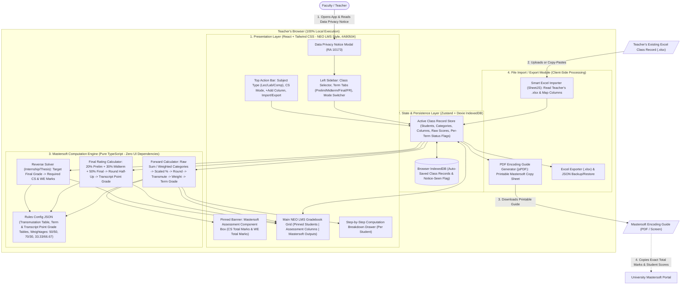
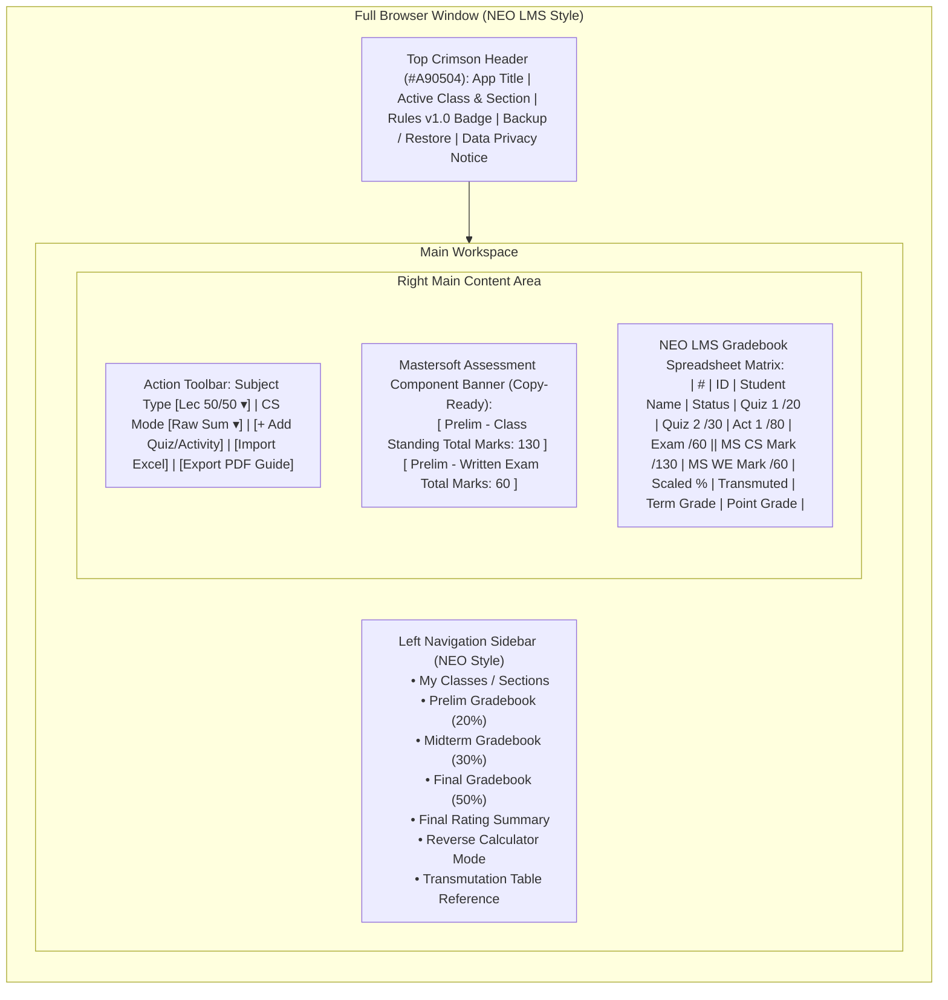

# System Architecture & Flowcharts

This document presents the complete visual architecture and flowcharts for the **Mastersoft Grade Encoding Web App** before we write any code.

---

## 1. High-Level System Architecture

Everything runs **100% inside the teacher's browser** (Client-Side Single Page Application). No student grades or names are sent to any external server.

---

## 2. End-to-End Application Flowchart (User Journey)

This flowchart shows every step a teacher takes from opening the app to encoding in Mastersoft, covering both **Forward Mode** (regular subjects) and **Reverse Mode** (internship/thesis).

```mermaid
flowchart TD
  START(["Teacher Opens Web App"]) --> CONSENT{"Has Seen the Data Privacy Notice (RA 10173)?"}
  CONSENT -->|"No (First Visit)"| SHOW_DPA["Display the App's Data Privacy Notice (data stays in this browser; not an official University system)"]
  SHOW_DPA --> CHECK_DPA["Teacher Clicks 'Continue'"]
  CHECK_DPA --> SAVE_DPA["Save 'Notice Seen' Flag in Browser Storage"]
  SAVE_DPA --> DASHBOARD
  CONSENT -->|"Yes"| DASHBOARD["Load NEO LMS-Style Gradebook Workspace"]

  DASHBOARD --> CLASS_SEL{"Create New Class or Open Saved Class?"}
  CLASS_SEL -->|"New Class"| SETUP["Enter Subject Code, Name, Section & Select Subject Type:
  • Lecture (50% CS / 50% WE)
  • Laboratory (70% CS / 30% WE)
  • Composite (33.33% CS / 66.67% WE)"]
  CLASS_SEL -->|"Open Saved / Restore Backup"| LOAD_CLASS["Load Class Record from Browser IndexedDB or Backup File"]

  SETUP --> MODE{"Select Grading Mode"}
  LOAD_CLASS --> MODE

  %% FORWARD MODE BRANCH
  MODE -->|"Forward Mode (Regular Class Record)"| TERM_TAB["Select Term Tab: Prelim (20%) | Midterm (30%) | Final (50%)"]
  TERM_TAB --> CS_MODE{"How does teacher compute Class Standing?"}
  CS_MODE -->|"Standard Raw Sum (Mastersoft Default)"| ADD_COLS["Define Assessment Columns in Gradebook Header
  e.g., Quiz 1 (/20), Quiz 2 (/30), Activity (/50) -> Tagged as CS
  Term Exam (/60) -> Tagged as WE"]
  CS_MODE -->|"Weighted Categories inside CS"| ADD_W_COLS["Define This Term's CS Categories & Weights (e.g., Quiz 40%, Activity 60%; must total 100%)
  App sets CS Total Marks = 100 and CS Mark = roundHalfUp(weighted CS %), a whole number"]

  ADD_COLS --> INPUT_METHOD{"How to Enter Student Scores?"}
  ADD_W_COLS --> INPUT_METHOD
  INPUT_METHOD -->|"Smart Excel Import"| EXCEL_MAP["Upload Teacher's .xlsx -> Pick Sheet -> Map Name, ID, CS Columns & WE Column"]
  INPUT_METHOD -->|"Direct Grid Entry / Paste"| GRID_TYPE["Type or Paste Scores Directly into NEO LMS-Style Grid & Set This Term's Status Flags (INC/ABS/HNA/DRP/WP; DRP/WP carry forward)"]

  EXCEL_MAP --> VALIDATE{"Validate All Scores"}
  GRID_TYPE --> VALIDATE
  VALIDATE -->|"Error: Score > Max or Total Marks = 0"| FIX_ERR["Highlight Invalid Cell in Red & Show Warning"]
  FIX_ERR --> GRID_TYPE

  VALIDATE -->|"Valid"| RUN_ENGINE["Run Mastersoft Computation Engine"]

  %% REVERSE MODE BRANCH
  MODE -->|"Reverse Mode (Internship / Thesis)"| REV_INPUT["Teacher Inputs Target Final Rating per Student
  (Either Transmuted Grade 60–100 or Point Grade 1.0–3.0 / 5.0;
  a 5.0 target also needs an exact transmuted grade 60–74)"]
  REV_INPUT --> RUN_REV["Reverse Solver Computes Exact CS Marks (/100) & WE Marks (/100)
  for Prelim, Midterm, and Final so Mastersoft Produces Target Grade"]
  RUN_REV --> DISPLAY_RESULTS

  %% RESULTS & ENCODING
  RUN_ENGINE --> DISPLAY_RESULTS["Display Live Results in Gradebook:
  1. Top Banner: Exact Total Marks to input in Mastersoft 'Assessment Components'
  2. Pinned Right Columns: Exact CS Mark & WE Mark to input per student in 'Grade Encoding'
  3. Predicted Mastersoft Term Grade, Final Rating & Point Grade"]

  DISPLAY_RESULTS --> INSPECT{"Click a Student Row?"}
  INSPECT -->|"Yes"| BREAKDOWN["Open Step-by-Step Breakdown Drawer
  Shows: Raw -> Scaled % -> Rounded % -> Transmuted -> Weighted -> Term Grade -> Point Grade"]
  INSPECT -->|"No"| EXPORT_STEP

  BREAKDOWN --> EXPORT_STEP["Export / Print Mastersoft Encoding Guide (PDF or .xlsx)"]
  EXPORT_STEP --> ENCODE(["Teacher Copies Values into Mastersoft with 100% Accuracy"])
```

---

## 3. Mastersoft Computation Pipeline Flowchart (Inside the Engine)

This is the exact mathematical flowchart the TypeScript engine executes for every student. Steps 4–10 are verified by the GE 6, EE 231a (Lab) and EE 231 (Lec) test data. Steps 1–3 (scaling and the transmutation lookup) were checked once against the BSED SS 3-A screenshot, which is no longer available, so they await a new raw-mark test case (D33).

`roundHalfUp` is the engine's own half-up rounding function. It works on integer hundredths (`marks × 10000 ÷ total`) and is used for every rounding step; `Math.round` is never applied to a decimal result, because an exact `.5` can be stored as `.4999…` and rounded down.

```mermaid
flowchart TD
  START(["Student Row in Active Term"]) --> STATUS{"Has Special Status in This Term?
  (INC / ABS / HNA / DRP / WP)"}
  STATUS -->|"Yes"| SKIP["Set Marks = Status Flag, Scaled = 0.00
  Skip Numeric Grade Computation"]

  STATUS -->|"No (Regular)"| CS_SUM["Sum Class Standing Raw Scores:
  CS_Raw = Σ(student CS scores)
  CS_Total = Σ(CS column max scores)"]
  CS_SUM --> WE_SUM["Written Exam Raw Score:
  WE_Raw = student exam score
  WE_Total = exam max score"]

  %% CS Branch
  CS_SUM --> CS_SCALE["Step 1A: Scale CS to 100%
  CS_Scaled = round2((CS_Raw / CS_Total) × 100)"]
  CS_SCALE --> CS_ROUND["Step 2A: Round to Whole Integer (Half-Up)
  CS_Pct = roundHalfUp(CS_Scaled)
  (x.495–x.499 raw % → amber 'unverified boundary' badge)"]
  CS_ROUND --> CS_TRANS["Step 3A: Lookup in Transmutation Table
  CS_Trans = TransmutationTable[CS_Pct] (60 to 100, whole numbers)
  (CS_Pct below 38 → amber 'unverified' badge)"]
  CS_TRANS --> CS_WEIGHT["Step 4A: Multiply by Subject CS Weight
  • Lec: × 0.50 | Lab: × 0.70 | Comp: × 0.3333
  CS_Weighted = CS_Trans × W_CS"]

  %% WE Branch
  WE_SUM --> WE_SCALE["Step 1B: Scale WE to 100%
  WE_Scaled = round2((WE_Raw / WE_Total) × 100)"]
  WE_SCALE --> WE_ROUND["Step 2B: Round to Whole Integer (Half-Up)
  WE_Pct = roundHalfUp(WE_Scaled)
  (x.495–x.499 raw % → amber 'unverified boundary' badge)"]
  WE_ROUND --> WE_TRANS["Step 3B: Lookup in Transmutation Table
  WE_Trans = TransmutationTable[WE_Pct] (60 to 100, whole numbers)
  (WE_Pct below 38 → amber 'unverified' badge)"]
  WE_TRANS --> WE_WEIGHT["Step 4B: Multiply by Subject WE Weight
  • Lec: × 0.50 | Lab: × 0.30 | Comp: × 0.6667
  WE_Weighted = WE_Trans × W_WE"]

  %% Combine into Term Grade
  CS_WEIGHT --> TERM_SUM["Step 5: Add Weighted Components
  Raw_Term = CS_Weighted + WE_Weighted"]
  WE_WEIGHT --> TERM_SUM
  TERM_SUM --> TERM_ROUND["Step 6: Round Half-Up (.5 rounds up)
  Term_Grade = roundHalfUp(Raw_Term)"]
  TERM_ROUND --> TERM_PG["Step 7: Lookup Term Point Grade (Term Table)
  Term_PG = TermPointGradeTable[Term_Grade]
  (75–100 -> 3.0–1.0; 60–74 -> internal 3.1–5.0 scale;
  only 70 and 73 verified, others get 'unverified' badge)"]

  %% Final Rating across 3 terms
  TERM_PG --> ANY_STATUS{"Status in Any Term?"}
  ANY_STATUS -->|"Yes"| FR_STATUS["Final Rating Shows the Most Serious Status
  DRP > WP > INC > HNA > ABS"]
  ANY_STATUS -->|"No"| ALL_TERMS{"Are Prelim, Midterm & Final Complete?"}
  ALL_TERMS -->|"No (Partial Semester)"| MIN_NEEDED["Compute Minimum Final Term Grade Needed
  to Reach 75 (Passing 3.0):
  Needed_Final = ceil((74.5 - 0.2·Prelim - 0.3·Midterm) / 0.5)"]
  MIN_NEEDED --> MIN_SHOW{"Needed_Final?"}
  MIN_SHOW -->|"> 100"| MIN_IMPOSSIBLE["Show: Cannot reach 75 even with a perfect Final"]
  MIN_SHOW -->|"< 60"| MIN_SAFE["Show: Passes with any Final grade"]
  MIN_SHOW -->|"60–100"| MIN_NUM["Show the number"]
  ALL_TERMS -->|"Yes"| FR_SUM["Step 8: Compute Weighted Final Rating
  FR_Raw = (0.20 × Prelim_Grade) + (0.30 × Midterm_Grade) + (0.50 × Final_Grade)"]
  FR_SUM --> FR_ROUND["Step 9: Round Half-Up to Integer
  FR_Grade = roundHalfUp(FR_Raw)"]
  FR_ROUND --> FR_PG["Step 10: Lookup Final Transcript Point Grade (Transcript Table)
  FR_PG = TranscriptPointGradeTable[FR_Grade] (75–100 -> 3.0–1.0; <75 -> 5.0)"]
```

---

## 4. UI Screen Architecture (NEO LMS Gradebook Layout)

How the components fit together visually on the screen using **`#A90504`** (without the university logo):

