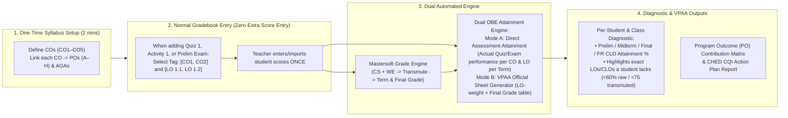
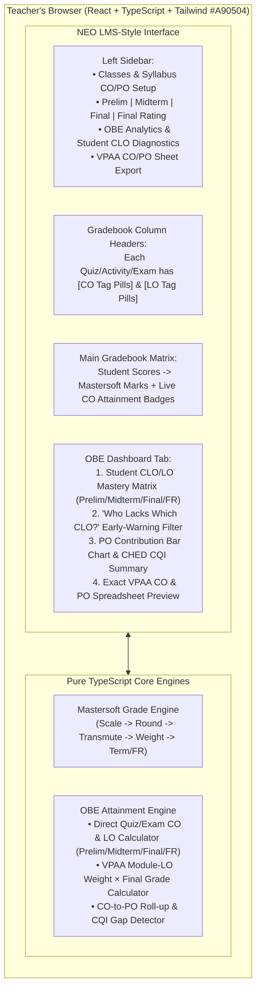

# OBE (Outcome-Based Education) Integration Blueprint & Claude Build Prompt

 This blueprint upgrades the **Mastersoft Grade Encoding Web App** into a unified **Mastersoft Grade Encoding + CHED/VPAA OBE Attainment System**. It is based directly on:
1. **Your VPAA OBE Spreadsheet** (`CO Attainment` and `PO Attainment` tabs for BS CpE / AB Comm).
2. **Your 2 University of San Agustin Course Syllabi** ([HM5/HM5A Applied Business Tools in Hospitality](file:///c:/Users/Marvin/Downloads/Course%20Syllabus/1st%20Sem%20AY%202025-2026%20UPDATED-HM5-Syllabi-Template-Pure-Lec_Lab.docx.pdf) and [CpE122 Discrete Mathematics](file:///c:/Users/Marvin/Downloads/Course%20Syllabus/2Guanzon-Syllabus2ndAY23-24-CpE122-Discrete-Math.docx.pdf)).
3. **CHED OBE Standards for Private HEIs** (**CMO No. 46, s. 2012** & the *CHED Handbook on Typology, Outcomes-Based Education, and Institutional Sustainability Assessment*).
4. **Mastersoft's TAG CO Button** (seen in your first screenshot right next to each Assessment Component's `Total Marks`).

---

## 1. Key Findings: What the VPAA Sheet vs. Faculty Need (and Why Your Idea Solves a Huge Problem)

### A. What the Current VPAA OBE Spreadsheet Does (`CO Attainment` & `PO Attainment` tabs)
In the spreadsheet you linked:
1. **Top Table (Module × CO Mapping):** The teacher maps how many Learning Outcomes (`LO 1`, `LO 2`, `LO 3`...) fall under each Course Outcome (`CO 1` to `CO 5`) per Module.
   - Example from `CpE111`: `CO 1 = 4 LOs (21.1%)`, `CO 2 = 4 LOs (21.1%)`, `CO 3 = 5 LOs (26.3%)`, `CO 4 = 5 LOs (26.3%)`, `CO 5 = 1 LO (5.3%)` → Total = `19 LOs (100%)`.
2. **Bottom Table (Student CO Contribution):** The sheet takes the student's **Final Grade** (e.g., Alice Guo = `75`) and simply multiplies it by the static CO weight (`75 × 21.1% = 15.79` for `CO 1`), then marks `"Attained"` if `Final Grade >= 75`.

> [!WARNING]
> **The Flaw in the Static Sheet (and Why Teachers & CHED Accreditors Want Real Assessment Mapping):**
> Because the spreadsheet only multiplies the *Final Grade* by the LO count percentage, a student who **aced CO 1 & CO 2 in Prelim** but **failed CO 4 in Finals** appears to have the exact same relative performance across every CO! It **cannot** tell the teacher *which specific CLO or LO a student lacked* in Prelim, Midterm, or Final.

### B. What the 2 USA Course Syllabi Reveal (`HM5` & `CpE122`)
Both syllabi follow the **University of San Agustin / CHED OBE Hierarchy**:
- **Augustinian Graduate Attributes (AGA):** `A` (Transformative community builder), `B` (Restless critical/creative thinker), `C` (Social communicator of Truth).
- **Program Outcomes (PO):** `A, B, C, D, E, F, G, H...` (or `a` through `n` in Engineering), optionally tagged with **I / P / D** (*Introduced, Practiced, Demonstrated*).
- **Course Outcomes (CO / CLO):** `CO1, CO2, CO3, CO4...` — each linked to specific **AGAs** and **PO Codes** (e.g. in HM5: `CO1 -> AGA: B, C | PO: A, D, E`).
- **Modules & Learning Outcomes (LOs) per Term:**
  - **PRELIM:** Modules 1–2 (`LO 1.1` to `LO 2.5`) → Assessed via *Quizzes, Group/Machine Activities, Recitation, Prelim Exam*.
  - **MIDTERM:** Modules 3–4 (`LO 3.1` to `LO 4.6`) → Assessed via *Quizzes, Machine Activities, Midterm Exam*.
  - **FINALS:** Modules 5–6 (`LO 5.1` to `LO 6.6`) → Assessed via *Quizzes, Final Output Rubric, Finals Exam*.
- **OBE Cutoff & Target Benchmarks (Page 8 of HM5 & Page 35 of CpE122):**
  - **Assessment Passing Cutoff:** **60% of raw score** (which transmutes to **75 / 3.0** in Mastersoft!).
  - **Cohort / Class Attainment Benchmark:** Typically **70% to 80%** of students must achieve the cutoff for a CO to be declared **Attained** at the class level (CHED CQI standard).

---

## 2. How "Zero-Extra-Work" OBE Integration Works in Our Web App

Teachers **never** have to encode grades twice or fill out a separate OBE Excel sheet. They just do their normal gradebook setup with **one click of a tag**:



### Dual OBE Calculation Modes (Supporting Both Teacher Diagnostics & VPAA Export!)
Because the VPAA has their existing spreadsheet format while teachers need **actual quiz/exam diagnostic OBE**, the engine computes **both automatically** from the same tagged columns:

1. **Direct Assessment OBE Mode (Diagnostic — Prelim, Midterm, Final & Overall):**
   - Every assessment column $j$ (e.g., `Quiz 1 /20`, `Machine Activity 1 /50`, `Prelim Exam /60`) is tagged with one or more Course Outcomes $c \in \{\text{CO1}, \text{CO2}, \dots\}$ and Learning Outcomes $l \in \{\text{LO 1.1}, \dots\}$.
   - *(Optional Exam Split)*: If a Periodic Exam covers multiple COs (e.g., Prelim Exam = 60 items covering M1 `CO1` and M2 `CO2`), the teacher can either tag the whole exam `[CO1, CO2]` (equal split) or enter item counts (`CO1: 30 pts, CO2: 30 pts`).
   - **Student's Direct CO Attainment % in Term $t$:**
     $$\text{CO}_{s,c,t}^{\text{raw}\%} = \frac{\sum_{j \in \text{Items}(c,t)} \text{Score}_{s,j}}{\sum_{j \in \text{Items}(c,t)} \text{MaxScore}_{j}} \times 100$$
   - **Status per Student per CO:**
     - **Attained** if $\text{CO}_{s,c,t}^{\text{raw}\%} \ge 60\%$ (which equals $\ge 75$ Transmuted Grade in Mastersoft!).
     - **Not Attained (Lacking)** if $< 60\%$ raw score — the app immediately flags which specific **CLO** and **LO** (e.g., `CO2 / LO 1.2`) the student failed and which quiz/exam pulled them down!
   - **Semester-Wide (Final Rating) Direct CO Attainment:**
     - Combines Prelim (20%), Midterm (30%), and Final (50%) CO performance (or total points across the semester) so the teacher sees how each student progressed from Prelim → Midterm → Final.

2. **VPAA Official Template Mode (100% Compatible with your Google Sheet):**
   - Automatically counts the mapped LOs per Module & CO, computes the exact **CO Weight %** (e.g. `21.1%, 21.1%, 26.3%, 26.3%, 5.3%`), and multiplies each student's **Mastersoft Final Rating** by each CO's weight so the teacher can **1-click export the exact VPAA `CO Attainment` & `PO Attainment` Excel sheet** without typing a single formula!

3. **Program Outcome (PO) Roll-Up & CHED CQI Loop (CMO No. 46, s. 2012):**
   - Since each `CO` is linked to `POs` (e.g., `CO1 -> PO A, D, E`), the app automatically rolls up the CO attainment into a **Course-to-Program Outcome (PO) Attainment Card** (`PO A: 88.4% Attained`, `PO D: 91.2% Attained`).
   - For any CO or LO where class attainment falls below the target threshold (e.g., `< 70%` or `< 80%` of students attained), the app flags it for **Continuous Quality Improvement (CQI)** so the teacher knows which topic needs remedial instruction.

---

## 3. Updated System Architecture (With OBE Engine)



---

## 4. Structured Master Prompt for Claude (Copy-Paste Ready)

Below is the **complete, structured architectural prompt** designed specifically for **Claude**. You can copy and paste the entire block below (or feed it phase-by-phase) into Claude so it builds the exact application with zero guesswork.

````markdown
# ROLE & OBJECTIVE
You are a Senior Full-Stack TypeScript/React Architect and EdTech Systems Engineer. Build a production-grade, client-side web application titled **"Mastersoft Grade Encoding & OBE Attainment Companion"** styled after the **NEO LMS Gradebook** (`#A90504` crimson theme, no university logo).

The app solves two intertwined problems for University faculty:
1. **Mastersoft Grade Encoding Accuracy:** Teachers record quizzes, activities, and exams in Excel, but Mastersoft computes grades using a specific multi-step rounding and transmutation pipeline. Before encoding into Mastersoft, the app shows the exact `Total Marks` for Mastersoft's *Assessment Components* screen, the exact `CS` and `WE` marks to encode per student, and the 100% exact Term Grade, Final Rating, and Point Grade Mastersoft will produce.
2. **Zero-Extra-Work CHED / VPAA Outcome-Based Education (OBE) Integration:** As teachers create quiz, activity, and exam columns in the gradebook, they simply tag each column with **Course Learning Outcomes (CLOs / COs)** and **Learning Outcomes (LOs)** (which are linked to **Program Outcomes [POs]** and **Augustinian Graduate Attributes [AGAs]**). From the student scores already entered, the app automatically calculates:
   - **Direct Diagnostic OBE Attainment** (per student and class-wide across **Prelim, Midterm, Final, and Final Rating**) to identify which specific CLOs and LOs each student has attained or lacks.
   - **VPAA Official OBE Spreadsheet Output** (`CO Attainment` and `PO Attainment` tabs) matching the University VPAA's exact Module × LO weighting formula.
   - **Program Outcome (PO) Contribution & CHED Continuous Quality Improvement (CQI) Insights** aligned with **CHED CMO No. 46, s. 2012**.

---

# TECH STACK & ARCHITECTURE CONSTRAINTS
- **Framework:** React 18 + TypeScript + Vite (Single-Page Application, 100% client-side execution).
- **Styling:** Tailwind CSS + `lucide-react` icons + `Poppins` / `Inter` fonts (`tabular-nums` for all numeric cells).
  - Primary Brand Color: `#A90504` (Crimson Red), hover `#8B0000`.
  - No university logo (independent faculty companion project).
- **State & Local Persistence:** `zustand` with `dexie` (IndexedDB) or `localStorage` persistence + JSON Backup/Restore file download.
- **Spreadsheet & PDF I/O:** `xlsx` (SheetJS) for Smart Excel Import and multi-tab Excel Export (Mastersoft Guide + VPAA `CO Attainment` & `PO Attainment` sheets); `jspdf` + `jspdf-autotable` for Printable PDF Encoding & OBE Reports.
- **Architecture Rule:** Keep all mathematical logic in a pure TypeScript module (`src/engine/`) with **zero React/UI imports** and 100% unit-test coverage (`vitest`).

---

# PART 1: EXACT MASTERSOFT GRADE COMPUTATION SPECIFICATION (VERIFIED GOLDEN RULES)

### 1. Subject Type Component Weightages (Class Standing `CS` vs. Written Exam `WE`)
- `LECTURE`: **CS = 50% (0.50)**, **WE = 50% (0.50)**
- `LABORATORY`: **CS = 70% (0.70)**, **WE = 30% (0.30)**
- `COMPOSITE` (Lec + Lab): **CS = 33.33% (0.3333)**, **WE = 66.67% (0.6667)**

### 2. Step-by-Step Term Grade Pipeline (Prelim, Midterm, Final)
For each term (`PRELIM`, `MIDTERM`, `FINAL`) and each student:
- **Special Status Check:** If student status is `INC`, `ABS`, `HNA`, `DRP`, or `WP`, skip numeric calculation, display the status code as the mark, and set `scaled = 0.00`.
- **Step 1 (Raw Totals):**
  - Default (`RAW_SUM` mode):
    - `CS_Raw` = sum of student's scores across all columns tagged `CS` in that term.
    - `CS_Total` = sum of `maxScore` across all columns tagged `CS` in that term (this is the exact number the teacher types into Mastersoft *Assessment Components -> Class Standing Total Marks*).
  - Optional (`WEIGHTED_CATEGORIES` mode):
    - If the teacher weights sub-categories inside CS (e.g., Quizzes 25% + Activities 25% = 50% CS), compute the normalized CS score out of `100` (`CS_Total = 100`, `CS_Raw = roundHalfUp(weightedCSPercentage)`). Show a comparison badge if `RAW_SUM` vs `WEIGHTED_CATEGORIES` differs.
  - `WE_Raw` = student's score on the term's Written/Periodic Exam; `WE_Total` = exam `maxScore`.
  - Validation: Block computation if `CS_Total <= 0` or `WE_Total <= 0` (mirroring Mastersoft's `"The total marks value should be 100 !!!"` error when left zero).
- **Step 2 (Scale to 100% with 2 decimals):**
  - `CS_Scaled = roundTo2Decimals((CS_Raw / CS_Total) * 100)`
  - `WE_Scaled = roundTo2Decimals((WE_Raw / WE_Total) * 100)`
- **Step 3 (Round Half-Up to Integer Percentage):**
  - `CS_Pct = Math.floor(CS_Scaled + 0.5)` ( clamped `0..100` )
  - `WE_Pct = Math.floor(WE_Scaled + 0.5)` ( clamped `0..100` )
- **Step 4 (Mastersoft Transmutation Table Lookup `0..100 -> 60..100`):**
  Use this exact lookup array/map for `pct` from `0` to `100`:
  - `100->100`, `99->99`, `98->99`, `97->98`, `96->98`, `95->97`, `94->96`, `93->96`, `92->95`, `91->94`, `90->94`, `89->93`, `88->93`, `87->92`, `86->91`, `85->91`, `84->90`, `83->89`, `82->89`, `81->88`, `80->88`, `79->87`, `78->86`, `77->86`, `76->85`, `75->84`, `74->84`, `73->83`, `72->83`, `71->82`, `70->81`, `69->81`, `68->80`, `67->79`, `66->79`, `65->78`, `64->78`, `63->77`, `62->76`, `61->76`, `60->75`
  - Below `60%` (60% is the passing raw cutoff = 75 transmuted):
    - `57..59 -> 74`, `50..56 -> 73`, `46..49 -> 72`, `42..45 -> 71`, `38..41 -> 70`, `34..37 -> 69`, `30..33 -> 68`, `26..29 -> 67`, `22..25 -> 66`, `18..21 -> 65`, `14..17 -> 64`, `10..13 -> 63`, `6..9 -> 62`, `2..5 -> 61`, `0..1 -> 60`.
- **Step 5 (Apply Component Weightages):**
  - `CS_Weighted = roundTo2Decimals(CS_Trans * w_cs)`
  - `WE_Weighted = roundTo2Decimals(WE_Trans * w_we)`
- **Step 6 (Term Grade - Round Half-Up):**
  - `Term_Raw = CS_Weighted + WE_Weighted`
  - `Term_Grade = Math.floor(Term_Raw + 0.5)`
- **Step 7 (Point Grade Lookup from Transmuted/Term Grade `60..100`):**
  - `100->1.0`, `99->1.1`, `98->1.2`, `97->1.3`, `96->1.3`, `95->1.4`, `94->1.5`, `93->1.6`, `92->1.7`, `91->1.7`, `90->1.8`, `89->1.9`, `88->2.0`, `87->2.1`, `86->2.1`, `85->2.2`, `84->2.3`, `83->2.4`, `82->2.5`, `81->2.5`, `80->2.6`, `79->2.7`, `78->2.8`, `77->2.9`, `76->2.9`, `75->3.0`.
  - For grades `< 75`: Transcript Point Grade = `5.0` (also store internal reference grade: `74->3.1`, `73->3.2/3.3`, `72->3.4`, `71->3.6`, `70->3.7`, `69->3.8`, `68->3.9`, `67->4.1`, `66->4.2`, `65->4.3`, `64->4.5`, `63->4.6`, `62->4.7`, `61->4.9`, `60->5.0`).

### 3. Final Rating (FR) Across Prelim, Midterm, Final
- **Formula:** Uses the integer `Term_Grade` of each term with a **20% Prelim / 30% Midterm / 50% Final** split:
  - `FR_Raw = (0.20 * Prelim_Grade) + (0.30 * Midterm_Grade) + (0.50 * Final_Grade)`
  - `FR_Grade = Math.floor(FR_Raw + 0.5)` (Round Half-Up)
  - `FR_PointGrade = PointGradeLookup[FR_Grade]`
- **Minimum Final Grade Needed to Pass (75):** When Prelim and Midterm are encoded but Final is still pending, display:
  - `Min_Final_Needed = Math.ceil((74.5 - (0.20 * Prelim_Grade) - (0.30 * Midterm_Grade)) / 0.50)`

### 4. Reverse Mode (For Thesis / Internship / Practicum)
- Teacher inputs desired `Target_FR` (as integer `60..100` or Point Grade `1.0..3.0`).
- Engine looks up the lowest raw percentage `p` such that `Transmute(p) == Target_FR` (e.g., for `Target_FR = 93`, `p = 88` or `89`), sets `CS_Total = 100, WE_Total = 100`, and outputs `CS_Mark = p, WE_Mark = p` across Prelim, Midterm, and Final so Mastersoft computes the exact target grade.

---

# PART 2: OBE (OUTCOME-BASED EDUCATION) ENGINE SPECIFICATION

### 1. OBE Data Model (Aligned with USA Syllabi & CHED CMO No. 46, s. 2012)
Each `ClassRecord` contains an `obeConfig`:
- **`agas` (Augustinian Graduate Attributes):**
  - `A`: "A transformative community builder oriented towards God"
  - `B`: "A restless critical and creative thinker"
  - `C`: "A social communicator of the Truth"
- **`programOutcomes` (`PO[]`):** `{ id, code: 'A'|'B'|...|'a'|'b'..., description: string }`
- **`courseOutcomes` (`CO[]` / CLOs):**
  - `{ id, code: 'CO1'|'CO2'|..., description: string, agaLinks: string[], poLinks: { poCode: string, level?: 'I'|'P'|'D' }[], targetStudentPassPct: number (default 60), targetClassAttainmentPct: number (default 75) }`
- **`modules` (`CourseModule[]`):**
  - `{ id, code: 'M1'|'M2'|..., title: string, term: 'PRELIM'|'MIDTERM'|'FINAL', coLinks: string[] }`
- **`learningOutcomes` (`LO[]`):**
  - `{ id, code: 'LO 1.1'|'LO 1.2'|..., description: string, moduleId: string, coId: string }`
- **Assessment Column OBE Mapping (`Column.obeMapping`):**
  - Every gradebook column (Quiz, Activity, Recitation, Machine Hands-on, Periodic Exam) has:
    - `coIds: string[]` (one or more Course Outcomes)
    - `loIds: string[]` (one or more Learning Outcomes)
    - `coPointSplits?: Record<string, number>` (optional: allows a 60-item Periodic Exam to split points across COs, e.g., `{ CO1: 25, CO2: 20, CO3: 15 }`; if omitted, points are distributed equally across tagged `coIds`).

### 2. Dual OBE Computation Engine
Implement **both** OBE calculation methods in `src/engine/obeEngine.ts`:

#### Method 1: Direct Assessment OBE Attainment (Teacher & Student Diagnostic across Prelim, Midterm, Final, and Overall)
- For any scope $S \in \{\text{PRELIM}, \text{MIDTERM}, \text{FINAL}, \text{OVERALL}\}$ and each Course Outcome $c$ (and Learning Outcome $l$):
  - Gather all assessment columns $j$ in scope $S$ mapped to $c$.
  - Let $w_{j,c}$ be the share of column $j$'s points assigned to $c$ (either `coPointSplits[c] / maxScore` or `1 / j.coIds.length`).
  - **Student $s$'s Earned & Max Points for $c$ in scope $S$:**
    $$\text{Earned}_{s,c,S} = \sum_{j} \text{Score}_{s,j} \cdot w_{j,c}, \quad \text{Max}_{c,S} = \sum_{j} \text{MaxScore}_{j} \cdot w_{j,c}$$
  - **Student $s$'s Raw Attainment %:**
    $$\text{RawPct}_{s,c,S} = \frac{\text{Earned}_{s,c,S}}{\text{Max}_{c,S}} \times 100$$
  - **Student $s$'s Transmuted OBE Grade:** `Transmute(roundHalfUp(RawPct))`
  - **Attainment Status per Student:**
    - `ATTAINED` if `RawPct >= co.targetStudentPassPct` (default `60%` raw = `75` transmuted).
    - `LACKING` if `< 60%` raw. Return the list of specific `LO` codes and assessments where the student scored `< 60%` so the teacher sees *why* the student lacked that CLO.
  - **Term-Weighted Overall CO Attainment:** Also provide the `20% Prelim + 30% Midterm + 50% Final` weighted CO score alongside cumulative points.
  - **Cohort / Class Attainment per CO:**
    - `studentsAttainedCount` = number of regular students with `ATTAINED`.
    - `classAttainmentPct = (studentsAttainedCount / totalRegularStudents) * 100`.
    - `isClassTargetMet = classAttainmentPct >= co.targetClassAttainmentPct` (if `false`, flag for **CHED CQI Action Plan**).

#### Method 2: VPAA Official Spreadsheet Formula (`CO Attainment` & `PO Attainment` Generator)
- Replicates the exact University VPAA OBE Excel template:
  - Build the `Module × CO` matrix showing which `LOs` belong to each `(Module, CO)` cell.
  - Count `LO_Count[c]` for each CO $c$, and `Total_LOs = sum(LO_Count)`.
  - Compute `VPAA_CO_Weight[c] = LO_Count[c] / Total_LOs` (e.g., `4/19 = 21.05%`).
  - For each student $s$ with Final Grade `FG_s`:
    - `VPAA_CO_Contribution[s, c] = roundTo2Decimals(FG_s * VPAA_CO_Weight[c])`
    - `Total_Contribution = sum(VPAA_CO_Contribution[s, c])` (= `FG_s`)
    - `Remarks = FG_s >= 75 ? "Attained" : "Not Attained"`
  - Footer rows: `No. of students attained`, `% students attained CO`, `No. of students not attained`, `% students not attained CO`.

#### Method 3: Program Outcome (PO) Contribution Roll-Up
- For each Program Outcome `PO` linked to one or more `COs`:
  - Compute the course's **Direct PO Attainment %** = average `RawPct` (and `% of students attained`) across all `COs` mapped to that `PO`.
  - Generate the **Course-to-PO Mapping Row** (`1` if mapped, blank/`0` if unmapped, plus total mapped POs and `%` share) matching the VPAA `PO Attainment` tab.

---

# PART 3: UI / UX SPECIFICATION (NEO LMS GRADEBOOK STYLE)

1. **First-Launch Data Privacy Statement & Consent Modal (RA 10173):**
   - Displays the verbatim University of San Agustin **Data Privacy Statement and Consent** under **Republic Act No. 10173 (Data Privacy Act of 2012)** plus a local-storage guarantee badge (*"100% Local Browser Processing — No student data leaves your device"*).
2. **Top Header Bar (`#A90504`):**
   - App title, active Course & Section selector, Subject Type badge (`Lecture 50/50`, `Lab 70/30`, `Composite 33.33/66.67`), Backup/Restore JSON buttons, and Data Privacy link.
3. **Left Collapsible Sidebar (NEO LMS Navigation):**
   - **Syllabus & OBE Setup:** Define/load COs (`CO1..CO5`), POs (`A..H`), Modules, and LOs (include 1-click preset templates for **HM5 Hospitality Lec/Lab** and **CpE122 Discrete Math** so teachers can test immediately!).
   - **Term Gradebooks:** `Prelim (20%)`, `Midterm (30%)`, `Final (50%)`, and `Final Rating Summary`.
   - **OBE Attainment & Diagnostics:**
     - `Student CLO/LO Diagnostic Matrix` (Prelim, Midterm, Final, Overall — color-coded Green `Attained >=60%` vs Red `Lacking <60%`, with a filter for *"Show Students Lacking CLOs"*).
     - `VPAA Official CO & PO Sheet View` (exact replica of the VPAA spreadsheet, ready for 1-click `.xlsx` export).
     - `Program Outcomes (PO) & CHED CQI Report` (visual bars per PO + auto-generated CQI intervention recommendations for any CO/LO below target).
   - **Reverse Calculator Mode** (Internship / Thesis).
   - **Transmutation Table Reference**.
4. **Gradebook Header & Mastersoft "TAG CO" Integration:**
   - Above the student grid, show the **Mastersoft Assessment Component Banner** (`Class Standing Total Marks: X`, `Written Exam Total Marks: Y`, plus the mapped `TAG CO` pills so the teacher also knows which COs to tag inside Mastersoft's `TAG CO` modal!).
   - In every Quiz/Activity/Exam column header, display interactive **CO & LO Tag Pills** (e.g., `[CO1] [LO 1.1]`) that the teacher can click to toggle without leaving the gradebook.
5. **Student Breakdown & OBE Diagnostic Drawer:**
   - Clicking any student row opens a side drawer with two tabs:
     - **Tab 1: Mastersoft Grade Breakdown** (`Raw -> Scaled % -> Rounded % -> Transmuted -> Weighted -> Term Grade -> Point Grade`).
     - **Tab 2: Student OBE Profile** (Bar chart of `CO1..CO5` attainment across Prelim/Midterm/Final, highlighting which specific LOs and quizzes the student lacked).
````

---

## 5. Saved Copy in Your Workspace & Next Steps

I will also save this complete OBE Blueprint & Claude Prompt into your project's `docs/` folder as `docs/04_obe_integration_and_claude_prompt.md`.

### Quick Questions to Fine-Tune Your OBE Setup (Optional):
1. **Default Student CLO Passing Cutoff:** Both your `HM5` and `CpE122` syllabi state *"Cut off score = 60% of raw score"* (which equals **75 / 3.0** after Mastersoft transmutation), while the VPAA sheet checks `Final Grade >= 75`. Keeping **60% raw (75 transmuted)** as the default student attainment threshold (and **75% of the class** as the default cohort target, editable per course) covers both—does that match what you want?
2. **Exam Multi-CO Tagging:** When a teacher creates a `Prelim Exam (/60)` column that covers `CO1` and `CO2`, she can just click `[CO1, CO2]` for an automatic 50/50 split (zero extra work), with an optional *"Custom item split (e.g. CO1: 40 pts, CO2: 20 pts)"* if she wants Table of Specifications (TOS) precision. Should we include that optional TOS item split?