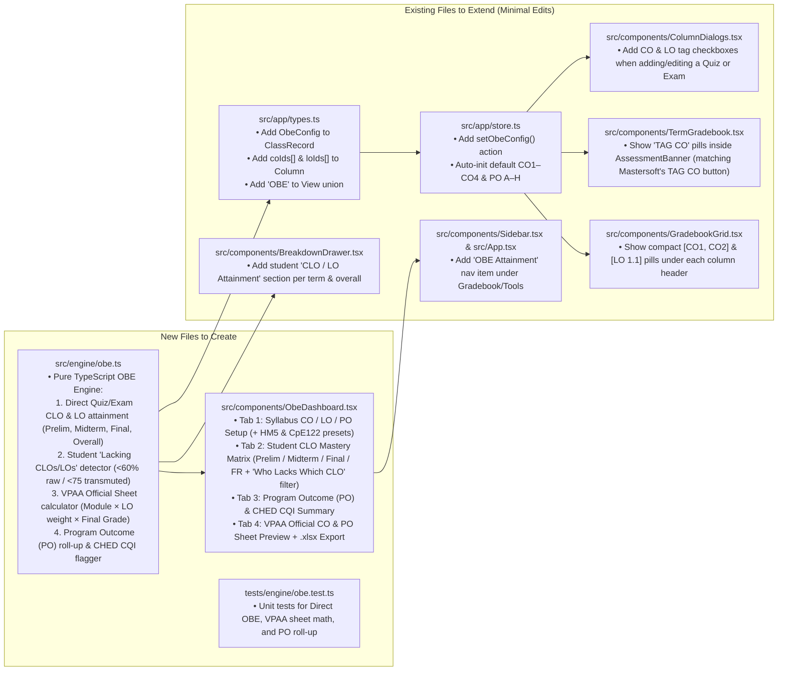

# Codebase-Aware OBE Upgrade Plan & Token-Saving Claude Prompts

I inspected your actual deployed project folder on this laptop (`C:\Users\Marvin\Documents\Claude Projetcs\Mastersoft Grade Encoding Web App`) and your live app (`https://mastersoft-grade-assistant.web.app/`).

### Why This Saves Your Claude Weekly Quota (Currently at 80% Used)
In your screenshot, your Claude session is at **670k / 1M context (67% full)** and **80% of your weekly Pro limit**.
- **Critical Tip #1:** Start a **New Chat** (or run `/compact`) in Claude before sending the OBE prompt! Sending a message in a 670k-token chat burns ~670k tokens on *every single turn*, which will hit your 100% weekly limit in 2–3 messages.
- **Critical Tip #2:** Because I already read your exact codebase files (`src/app/types.ts`, `src/app/store.ts`, `src/app/gradebook.ts`, `src/components/ColumnDialogs.tsx`, `src/components/TermGradebook.tsx`, `src/components/GradebookGrid.tsx`, `src/components/BreakdownDrawer.tsx`, `src/components/Sidebar.tsx`), the prompts below give Claude the **exact file paths and interfaces** to extend. Claude won't waste tokens searching your repo!
- **Critical Tip #3:** Or, if you want to **save 100% of your remaining Claude quota**, **I (Antigravity) can directly code, run `vitest`, build, and deploy this OBE upgrade into `C:\Users\Marvin\Documents\Claude Projetcs\Mastersoft Grade Encoding Web App` right now for you!**

---

## 1. How OBE Plugs Directly Into Your Existing Codebase

Here is the exact file-by-file integration map for your existing repository:



---

## 2. Token-Optimized Prompt for Claude (Broken into 2 Clean Prompts)

If you want Claude to build it without hitting your weekly limit, **open a fresh conversation in Claude Code** inside `C:\Users\Marvin\Documents\Claude Projetcs\Mastersoft Grade Encoding Web App` and paste **Prompt A** first, then **Prompt B**.

### Prompt A — Pure Engine + Data Model + Unit Tests (Paste into a New Claude Session)

````markdown
We are adding Outcome-Based Education (OBE) attainment tracking to this existing repo (`Mastersoft Grade Encoding Web App`). To save tokens, do NOT re-explore the whole repo—only read the specific files listed below.

### GOAL OF STEP 1 (Engine + Types + Store)
1. **Create `src/engine/obe.ts` (and re-export from `src/engine/index.ts`):**
   Pure TypeScript OBE computation engine (zero UI imports) supporting University of San Agustin syllabi, VPAA OBE spreadsheets, and CHED CMO No. 46 s. 2012 CQI standards:
   - **Data Types:**
     - `ProgramOutcome`: `{ id: string; code: string; description: string }` (e.g., `A..H` or `a..n`).
     - `CourseOutcome` (CLO / CO): `{ id: string; code: string; description: string; agaCodes: ('A' | 'B' | 'C')[]; poCodes: string[]; passRawPct: number; targetClassPct: number }` (defaults: `passRawPct = 60` which equals `75` transmuted in Mastersoft; `targetClassPct = 75`).
     - `LearningOutcome` (LO): `{ id: string; code: string; moduleCode: string; term: Term; coId: string; description: string }`.
     - `ObeConfig`: `{ programName?: string; collegeName?: string; pos: ProgramOutcome[]; cos: CourseOutcome[]; los: LearningOutcome[] }`.
   - **Calculation 1 — Direct Assessment CLO & LO Attainment (Diagnostic per Student & Class across `PRELIM`, `MIDTERM`, `FINAL`, and `OVERALL`):**
     - Each `Column` in a term can be tagged with `coIds?: string[]` and `loIds?: string[]` (and optional `coWeights?: Record<string, number>`).
     - If a column is tagged with $k$ COs and no custom `coWeights`, split the column's `score` and `maxScore` equally ($1/k$) across each tagged CO (or compute unweighted sum of raw score / max score across all columns tagged with that CO—support direct raw percentage: $\text{RawPct}_{s,c} = \frac{\sum \text{score}_{s,j}}{\sum \text{maxScore}_j} \times 100$ for all columns $j$ tagged with CO $c$ in that term/overall).
     - A student **Attains** CO $c$ (or LO $l$) in a term/overall if `RawPct >= co.passRawPct` (default `60%` raw, which corresponds to `75` transmuted).
     - Return for each student:
       - Per-term (`PRELIM`, `MIDTERM`, `FINAL`) and `OVERALL` (all 3 terms combined) `rawEarned`, `rawMax`, `rawPct`, `transmutedGrade` (via `rules.transmutation`), and `attained: boolean` for each CO and LO.
       - `lackingCoCodes: string[]` and `lackingLoCodes: string[]` plus the specific assessment column labels where the student scored `< 60%`, so teachers immediately see *which* CLO/LO the student lacks and why.
     - Return for the class/cohort per CO:
       - `attainedCount`, `totalGraded`, `attainmentPct`, `meanRawPct`, and `cqiFlag: boolean` (`attainmentPct < co.targetClassPct`).
   - **Calculation 2 — VPAA Official Spreadsheet Formula (`CO Attainment` & `PO Attainment` tabs):**
     - Replicate the VPAA spreadsheet:
       - Count how many `LearningOutcome` items (`los`) are mapped to each `CO`.
       - `vpaaWeightPct[coId] = loCount[coId] / totalLos` (if `totalLos === 0`, distribute equally `1 / cos.length`).
       - For each student with a computed Mastersoft Final Rating `finalGrade` (integer `60..100`):
         - `coContribution[coId] = Math.round(finalGrade * vpaaWeightPct[coId] * 100) / 100`.
         - `attained = finalGrade >= 75`.
       - Class summary: `No. of students attained`, `% students attained CO`, `No. of students not attained`, `% students not attained CO`.
   - **Calculation 3 — Program Outcome (PO) Contribution Roll-Up:**
     - For each `PO`, aggregate all `COs` linked to `po.code`: compute average `attainmentPct` and `meanRawPct` across linked COs, plus the binary Course-to-PO mapping row (`1` if any CO links to that PO, else `0`).
   - **Built-in Syllabus Presets (`OBE_PRESETS`):**
     - Include 3 presets:
       1. `DEFAULT_3CO`: `CO1, CO2, CO3` + `PO A..E` + `LO 1.1..3.2`.
       2. `HM5_HOSPITALITY`: USA College of Business `HM 5 / HM5A` (`CO1..CO3`, `PO A..H`, `LO 1.1..6.6` across M1–M6).
       3. `CPE122_DISCRETE_MATH`: USA College of Technology `CpE 122` (`CO1..CO4`, `PO a, m`, `LO1..LO6` across M1–M8).

2. **Extend `src/app/types.ts` and `src/app/store.ts`:**
   - In `Column`: add optional `coIds?: string[]` and `loIds?: string[]`.
   - In `ClassRecord`: add optional `obe?: ObeConfig`.
   - In `View`: add `'OBE'` (`export type View = Term | 'SUMMARY' | 'OBE' | 'REVERSE' | 'TABLE'`).
   - In `src/app/store.ts`: add `setObeConfig(obe: ObeConfig): void` to update `activeClass.obe`.

3. **Add Unit Tests in `tests/engine/obe.test.ts`:**
   - Test Direct CO/LO attainment across Prelim/Midterm/Final/Overall, student lacking-CLO detection (`<60%` raw), VPAA sheet contribution (`Alice Guo 75 -> 15.79, 15.79, 19.74, 19.74, 3.95`), and PO roll-up. Run `npx vitest run` to verify all existing and new tests pass.
````

---

### Prompt B — Gradebook Tagging UI + OBE Diagnostic Dashboard + VPAA Excel Export

````markdown
Now complete Step 2 (UI Integration for OBE). Only read the files being modified:

1. **`src/components/ColumnDialogs.tsx`:**
   - In `ColumnForm`, if the active class has `record.obe?.cos.length` (or offer a quick "Initialize CO1–CO3" button right there if `record.obe` is not yet configured), show multi-select pill checkboxes for **Course Outcomes (`CO1`, `CO2`, ...)** and **Learning Outcomes (`LO 1.1`, ...)** filtered by the active `term`.
   - Save `coIds` and `loIds` onto the `Column` when submitted.

2. **`src/components/GradebookGrid.tsx` and `src/components/TermGradebook.tsx`:**
   - In `GradebookGrid.tsx`: inside each score column's `<th>` header button (right below `/ {c.maxScore}`), render compact pill badges for any mapped `CO` codes (e.g., `CO1 · CO2`) and `LO` codes so teachers see the OBE alignment right on the gradebook.
   - In `TermGradebook.tsx` (`AssessmentBanner`): inside `TotalCard` for Class Standing and Written Exam, display a `TAG CO: CO1, CO2...` badge showing the union of CO codes mapped to CS columns and WE columns in that term (mirroring Mastersoft's `TAG CO` button next to `Total Marks`).

3. **`src/components/BreakdownDrawer.tsx`:**
   - Below the `Final Rating` section in `Breakdown`, add an **"OBE Attainment (CLOs & LOs)"** section for that student showing:
     - Each CO's raw % in this term (`Earned / Max = X%`) and overall semester % with a green `Attained` (`>=60%`) or red `Lacking` (`<60%`) badge.
     - If any CO or LO is `<60%`, list the exact lacking `CLO / LO` and assessment column names.

4. **Create `src/components/ObeDashboard.tsx` and wire `'OBE'` view in `src/components/Sidebar.tsx` and `src/App.tsx`:**
   - Add an `OBE Attainment` item in `Sidebar.tsx` right under `Final Rating summary`.
   - `ObeDashboard.tsx` has 4 clean sub-tabs:
     - **1. Student CLO Diagnostic Matrix:** Filterable by `Prelim`, `Midterm`, `Final`, or `Overall (FR)`, plus a toggle `"Only show students lacking CLOs"`. Shows every student × every `CO` (`Raw %`, `Attained / Lacking` badge, count of `CLOs Attained: X / Y`, and lacking `LO` codes).
     - **2. Program Outcomes (PO) & CHED CQI:** Shows each `CO` and `PO` class attainment bar (`% of students >= 60%`), target benchmark, and automatic **CQI Action Needed** alerts for any CO/LO below target.
     - **3. VPAA Official Sheet (`CO & PO Attainment`):** Renders the exact University VPAA `RELATIONSHIP OF LESSONS/MODULE AND THE COURSE OUTCOMES` table and `CO Contribution Per Student` table, with a **`Download VPAA OBE Excel (.xlsx)`** button using `xlsx` (`SheetJS`) that exports both `CO Attainment` and `PO Attainment` worksheets.
     - **4. Syllabus CO / LO / PO Setup:** Lets the teacher load presets (`Default CO1–CO3`, `HM5 Hospitality`, `CpE122 Discrete Math`) or add/edit COs, LOs (per Module & Term), and POs.

Run `npx vitest run` and `npm run build` to verify zero TypeScript or test errors.
````

---

## 3. Also Saved in Both Folders!

I will save this codebase-aware plan and prompt into your `docs/` folder so you have it permanently.

> [!TIP]
> **Want me to implement this directly into `C:\Users\Marvin\Documents\Claude Projetcs\Mastersoft Grade Encoding Web App` for you right now?**
> Since I have full access to that folder on your laptop, I can write `src/engine/obe.ts`, update the UI components, run `npx vitest run` and `npm run build`, and even run `npm run deploy` to update `https://mastersoft-grade-assistant.web.app/`—saving 100% of your Claude weekly quota! Just say **"Build it here"** if you'd like me to do it, or use the prompts above in a fresh Claude session.